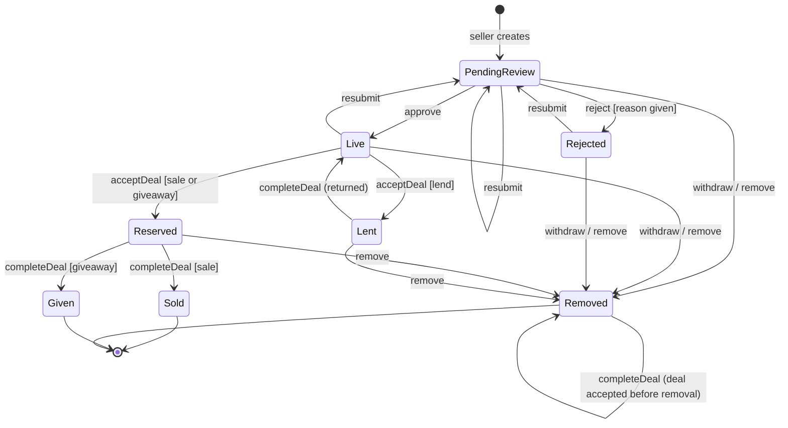
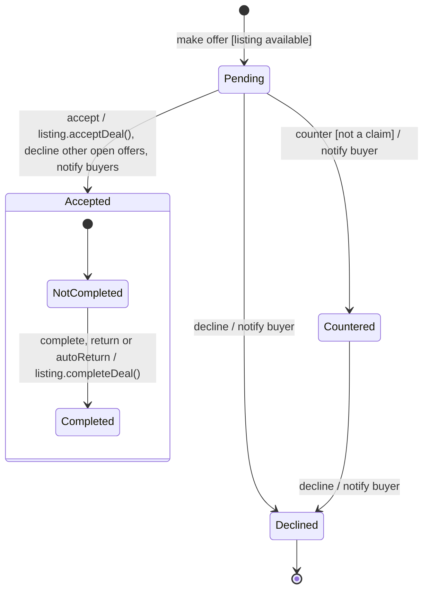

# State machines: Listing and Offer

`Listing` and `Offer` are the two classes whose behaviour spans use cases of **all three roles**, so each has a state machine (COMP 3111 Lecture 16). The code enforces both machines: an event that the diagram doesn't allow in the current state throws `IllegalStateException` and changes nothing. State-based tests: `ListingStateMachineTest`, `OfferTest`.

Transitions are written as *event [guard] / effect*, as in the lectures.

## Listing

| Event (method) | Who triggers it | Use case | Allowed from |
|---|---|---|---|
| *(create)* | Seller | Create Listings step 11 | starts in Pending Review |
| `approve()` | Admin | Manage Marketplace Listings 5.2; also right after the admin adds a listing (5.6.4) | Pending Review |
| `reject()` | Admin | 5.3 (reason stored in a `ListingActionRecord`) | Pending Review |
| `resubmit()` | Seller | Manage Listings 3.1.6 (edit saved). Per the client's answer of 16 Nov ([client-answers.md](client-answers.md) #5), not called when a **Live** listing with no open offers is edited: it stays Live (seller code still to do) | not locked |
| `withdraw()` | Seller | Manage Listings 3.2.4 (delete) | not locked |
| `remove()` | Admin | Manage Marketplace Listings 5.5.4; also for every listing of an account the admin deletes (6.4.4, via `DataStore.deleteAccount`) | anything except Sold, Given, Removed (`canBeRemoved()`) |
| `acceptDeal()` | Seller, via `DealRules.accept` | Manage Offers & Requests 3.3.4 | Live |
| `completeDeal()` | Buyer or timer, via `DealRules.complete` / `returnItem` | UC7 steps 6 and A2, UC12 step 3 | Reserved, Lent, Removed |

**Locked** (`isLocked()`): Reserved, Sold, Lent, Given or Removed. The seller can no longer edit or delete the listing (Manage Listings A2).

Not status changes: the admin's **edit** (Special Requirement 2: editing never changes the status) and **deactivating the seller**, which hides the listings without changing their status (they stop being "live").

## Offer (price offer, borrow request, claim)

- Only a **Pending** offer can be accepted or countered. A **Countered** offer can only be declined: the buyer agrees to a counter by making a new offer with its terms (UC5 Special Requirement 4).
- **Declined automatically**: the other open offers when one is accepted (UC7 Special Requirement 5), and the open offers on a listing the seller edits or deletes (Manage Listings A3), the admin removes (5.5.4), or whose seller is deactivated (6.2.4). Use `DealRules.declineOpenOffers`. When the admin deletes an account (6.4.4), `DataStore.deleteAccount` declines that account's own open offers and the open offers on its listings in the same step.
- **Completed** is a sub-state of Accepted: the deal gets a completion date. A price offer or claim is marked complete by the buyer; a borrow request is completed by returning the item, by the buyer before the due date or automatically at the due date. It is completed only once (UC12 Special Requirement 5).

## Decisions beyond the spec

These come from the team's assumptions register and need tests at every level:

1. If the admin removes a **Reserved** listing, its accepted deal can still be completed and the listing stays Removed, as UC12 A1 says for lent items. *(The client called this an edge case on 21 Nov, so it stays as built: [client-answers.md](client-answers.md) F2.)*
2. A listing is **available** only if its seller's account is active, in addition to the glossary's rule.
3. A seller can accept only a **Pending** offer, never a Countered one.
4. A borrow request whose period has already ended **cannot be accepted** (regression log R8); the seller declines it or counters with new dates. Otherwise it would be lent and returned automatically at once, completed before it was accepted.
5. Deleting an account leaves a deal that was **accepted but not completed** as it is: a borrowed item is still returned automatically at its due date, and the buyer of a reserved item can still mark the deal complete. Notifications to the deleted account are skipped.
