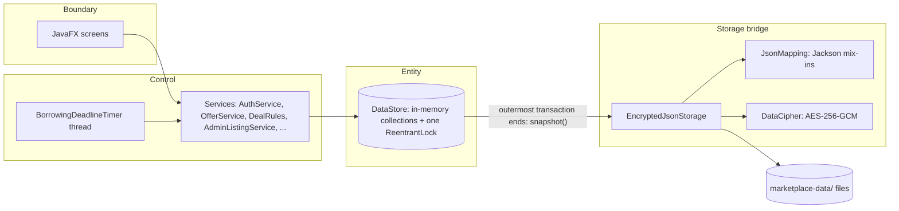

# Persistence layer manual: `DataStore` and the encrypted JSON save files

**Audience:** AI coding agents that read, change or test HKUST Marketplace code. Human readers should start with the README's [Saved Data](../README.md#saved-data) section.

**What this covers:** how the project stores its data, the guarantees it does and does not give, the API, the on-disk format, how to evolve the schema, and how to test and operate it.

**Status:** written on 2026-11-16. The persistence layer it describes (`data/` and `models/`) is identical on `BuyerDev` (`7d82ed1`), `origin/main` (`8e1999c`, which includes the admin listing service) and `SellerDev` (`982b334`). The code in `src/main/java/com/hkust/marketplace/data/` is the source of truth. If this manual and the code disagree, the code wins, and this manual should be fixed.

---

## 0. Operating contract for agents

These rules are normative. **MUST** and **MUST NOT** are used in the RFC 2119 sense. Each rule names the regression it prevents, where one exists (`docs/regression-log.md`).

1. All persistent state **MUST** be read and written through `DataStore`. No code outside `data/` opens, parses or writes files under `marketplace-data/`.
2. Model objects obtained from the store **MUST** be mutated only inside `store.transaction(...)`, or through a `DataStore` add method or a service that does so. A mutation made outside a transaction lives only in memory. It reaches the disk only if some later transaction happens to save, and it is lost if the app closes first (R4).
3. Code **MUST NOT** write inside `store.read(...)`. A transaction nested in a `read` never saves, because saving happens only when the lock's hold count returns to one inside a transaction (§6.3).
4. A service **MUST** finish every check before its first mutation, and throw `ServiceException` without changing anything when a check fails. There is no rollback (§6.4).
5. Every recorded date **MUST** come from `store.now()`, never `LocalDateTime.now()` (R1).
6. Tests **MUST** build their own store (`new DataStore(clock)`, or `Fixtures.store(clock)`) and inject it. They **MUST NOT** call `DataStore.getInstance()` or the no-argument constructor of any service, since both open the real save file relative to the working directory (R3).
7. Agents **MUST NOT** delete, overwrite, rename, hand-edit or "repair" anything under `marketplace-data/`. The folder holds the project owner's working data. This is a standing instruction from the owner.
8. Ad-hoc tooling **MUST NOT** call `DataStore.getInstance()` or `loadOrSeed()` against the real folder. An unreadable file would be renamed aside and demo data written in its place. Copy the file into a scratch directory first (§9.7, §11.5).
9. Agents **MUST NOT** change, without a migration plan:
   - `DataCipher`'s passphrase or the `HKMP1` marker;
   - the subtype names registered in `JsonMapping`;
   - persisted field names, constructor invariants or enum constants.

   Each of these can make every existing save file unreadable (§10).
10. Decrypted content (password hashes, chats, reports) **MUST** be treated as sensitive and **MUST NOT** be sent to external services.
11. Agents **MUST NOT** commit `marketplace-data/` (it is in `.gitignore`), and **MUST NOT** run the reset or practice-data scripts on the owner's data unless asked.

---

## 1. What the "database" is

There is no DBMS and no SQL. Persistence is an **in-process object store with snapshot-on-commit durability**:

- **Memory:** `DataStore` holds every entity in insertion-ordered collections (`LinkedHashMap`, `ArrayList`). It is the entity layer of the boundary/control/entity (BCE) architecture used throughout the project.
- **Concurrency:** a single `ReentrantLock` serializes every access. In effect, every transaction runs serially.
- **Durability:** when the *outermost* transaction completes normally, the whole store is serialized into one JSON document. The document is encrypted with AES-256-GCM and written to one file, replacing the previous one atomically. An unchanged document is not rewritten.
- **Side files:** blobs (listing photos) and per-event documents (audit-log snapshots of deleted accounts) go to separate encrypted files beside the main file.
- **Decoupling:** `DataStore` depends only on the `Storage` interface. Its Javadoc presents it as the bridge that encapsulates the implementation environment (Lecture 15). `EncryptedJsonStorage` is the only implementation the app uses. Tests use no storage at all (memory only), or a temporary folder.



| Database notion | Equivalent here |
|---|---|
| Table | A collection field of `DataStore` (`users`, `listings`, `offers`, `threads`, `reviews`, `reports`, `notifications`, `listingActions`, `auditLog`, `retiredUsernames`) |
| Primary key | The id string from the global counter (§7.1). Users are keyed by their lower-case username |
| Foreign key | An id or username field (`listingId`, `buyerUsername`, `offerId`, ...). Nothing enforces it beyond the checks some add methods make (§7.3) |
| Transaction | `store.transaction(...)`: serializable isolation, saved on commit, **no rollback** |
| Read-only transaction | `store.read(...)`: a consistent multi-read, never saves |
| Index | Only the primary key: `findUser`, `findListing`, `findOffer` and `findThreadById` are hash-map lookups. Every other query is a linear scan under the lock, which is adequate at course scale |
| Write-ahead log or journal | None. The whole document is rewritten on each committed change |
| Schema | The Java model classes, plus the Jackson mix-ins in `JsonMapping` |

---

## 2. Components

| Class or file | Package or path | Responsibility |
|---|---|---|
| `DataStore` | `data` | Collections, lock, transactions, ids and dates, queries, saving and loading. No role checks: services call `AccessControl` first |
| `DataStore.AppStore` | `data` (private holder class) | Lazily creates the app's singleton store on the first `getInstance()` call. A store created with `new DataStore(...)` never loads or writes the app's file (R3) |
| `Storage` | `data` | Interface: `load`, `save`, `setAsideUnreadable`, `saveAuditSnapshot`, `loadAuditSnapshot`, `savePhoto`, `loadPhoto` |
| `EncryptedJsonStorage` | `data` | The app's `Storage`: paths, temp file plus atomic move, skip-if-unchanged, set-aside, path-traversal guards. Its methods are `synchronized` (except `loadPhoto`) |
| `DataCipher` | `data` | AES-256-GCM envelope (§4.1). The key is derived from a passphrase built into the code |
| `JsonMapping` | `data` (package-private) | Jackson configuration and mix-ins, so the models carry no Jackson annotations |
| `StoreSnapshot` | `data` | Plain data-transfer object of public lists: what is serialized |
| `StorageException` | `data` | Unchecked: saved data could not be written, read or decrypted |
| `SeedData` | `data` | Demo data written on the first run (or after the file was set aside), dated in the past by swapping the store's clock |
| `AccountSnapshot`, `DeletedAccount` | `data` | The text snapshot and result of `deleteAccount` (Audit Log, Manage All User Accounts 6.4.4) |
| `PhotoService` | `services` | Imports image files (PNG, JPEG, GIF or BMP, recognized by their content) into photo storage. Only sellers and admins may call it |
| `DevLogin` | `utils` (DEV-ONLY) | `-Dmarketplace.dev=true` (Maven profile `-Pdev`) selects `marketplace-dev.dat` and adds dev accounts when seeding. Removed before release (pre-release checklist) |
| `MarketplaceApp` | root | Opens the store before the first screen, shows the load-problem warning, starts and stops the borrowing timer |
| `BorrowingDeadlineService` / `BorrowingDeadlineTimer` | `services` | A second writer thread (every 0.5 s). It reads first and opens a transaction only when there is work, so idle ticks never save |
| `scripts/reset-data.*`, `scripts/practice-data.*` | `scripts/` | Operator tools (§11) |

---

## 3. On-disk layout

All paths are relative to the **process working directory**: `DataStore.DATA_FOLDER = Path.of("marketplace-data")`. Running `mvnw javafx:run` from the repository root puts the folder there. An IntelliJ run configuration with another working directory creates a separate folder there instead.

| Path | Written by | Content |
|---|---|---|
| `marketplace-data/marketplace.dat` | `save` | Encrypted JSON of the whole store (normal runs) |
| `marketplace-data/marketplace-dev.dat` | `save` | The same for dev runs (`-Dmarketplace.dev=true`) |
| `marketplace-data/<base>-audit/<logReference>.txt` | `saveAuditSnapshot` | Encrypted UTF-8 text snapshot of a deleted account. `<base>` is the data file's name without `.dat`: `marketplace` or `marketplace-dev` |
| `marketplace-data/<base>-photos/<photoId>.img` | `savePhoto` | Encrypted raw image bytes |
| `<any of the above>.tmp` | every write | Transient: written first, then moved over the target. It survives only if the process dies between the two steps |
| `marketplace-data/<file>.dat.unreadable-<yyyyMMdd-HHmmss>` | `setAsideUnreadable` | A save file that failed to load, kept under a new name (local wall-clock time) |
| `marketplace-data/backups/<yyyyMMdd-HHmmss>/` | the scripts | Backups made by `reset-data` (moved files) and `practice-data` (copied save file) |

Each running app uses exactly one data file: dev mode picks `marketplace-dev.dat` (the line is tagged DEV-ONLY in `DataStore.createAppStore`).

---

## 4. File format

### 4.1 Encrypted envelope (every `.dat`, `.txt` and `.img` file)

| Offset (bytes) | Length | Content |
|---|---|---|
| 0 | 5 | ASCII `HKMP1`, the format marker. It is also the GCM additional authenticated data (AAD) |
| 5 | 12 | Random 96-bit nonce (`SecureRandom`), fresh on every write |
| 17 | n + 16 | AES-GCM ciphertext of the n-byte plaintext, followed by its 128-bit authentication tag |

- **Cipher:** `AES/GCM/NoPadding`, 256-bit key, 128-bit tag.
- **Key:** `SHA-256(UTF-8(DEFAULT_PASSPHRASE))`, where the passphrase is a constant in `DataCipher`. There is no salt and no per-installation secret, so every copy of the app can read every file.
- **Same input, different bytes:** encrypting the same plaintext twice gives different files, because the nonce is random.
- **Decryption failures** (both are `StorageException`):
  - Shorter than 18 bytes, or not starting with `HKMP1`: "The file is not a HKUST Marketplace save file."
  - Tag mismatch (`AEADBadTagException`): "The file was changed or damaged, or it was saved with a different key."

### 4.2 Plaintext of a `.dat` file: JSON of `StoreSnapshot`

The Jackson configuration in `JsonMapping.newMapper()`:

- **Properties are fields.** Every field is serialized, private ones included, and getters are ignored. Property names are therefore the Java field names, and derived values such as `getPriceDisplay()` are not saved.
- **Construction runs the model's own constructor**, chosen by an `@JsonCreator` mix-in; the remaining fields are then filled in. As a result, **constructor validation runs on load** (§10.4).
- **Polymorphism:** the abstract types `User`, `Listing` and `Offer` get a `"kind"` property whose value is a registered name. These are closed lists, and default typing is not used.
  - `User`: `Buyer`, `Seller`, `Admin`
  - `Listing`: `SaleListing`, `LendListing`, `GiveawayListing`
  - `Offer`: `PriceOffer`, `BorrowRequest`, `Claim`
- **Enums** are stored by constant name: `"PENDING_REVIEW"`, not the display name `"Pending Review"`.
- **`LocalDateTime`** is stored as an ISO-8601 local date-time with no time zone, for example `"2026-11-02T12:00:00"`. **`Duration`** is stored as ISO-8601, for example `"PT5S"`.
- **Unknown properties are ignored**, so files written by older code that had more fields still load.
- **No object graph:** records refer to each other by id or username, so the document has no cycles.

The top-level object and record shapes:

| `StoreSnapshot` field | Element type | Notes |
|---|---|---|
| `nextId` | int | Next value of the global id counter (§7.1). Restored as is, so ids never repeat after a restart |
| `users` | `User` (polymorphic) | Keyed in memory by `username` |
| `retiredUsernames` | string | Usernames of deleted accounts. Old files without this field load it as empty |
| `listings`, `offers` | polymorphic | Ids `L<n>` and `O<n>` |
| `threads` | `ChatThread` | Id `T<n>`, with embedded `messages` |
| `reviews`, `reports`, `notifications`, `listingActions` | concrete | Ids `R<n>`, `P<n>`, `N<n>`, `A<n>` |
| `auditLog` | `AuditLogEntry` | `logReference` is `G<n>`. `dataSnapshot` is also written to its own `.txt` file |

Persisted fields per record. They are the declared instance fields; a subtype's fields come after the inherited ones.

| Record | Fields |
|---|---|
| `User` | `username`, `fullName`, `passwordHash`, `active`, `createdAt` |
| ... `Buyer` | `residenceHall` |
| ... `Seller` | `bio`, `preferredMeetupLocations` |
| ... `Admin` | none |
| `Listing` | `id`, `sellerUsername`, `title`, `category`, `condition`, `description`, `photos` (photo ids, at most 6), `meetupLocation`, `postedDate`, `status`, `viewCount` |
| ... `SaleListing` | `price` |
| ... `LendListing` | `lendingDuration` |
| ... `GiveawayListing` | none |
| `Offer` | `id`, `listingId`, `buyerUsername`, `status`, `offerDate`, `acceptedDate`, `completedDate` |
| ... `PriceOffer` | `offeredPrice`, `counterPrice` |
| ... `BorrowRequest` | `proposedStartDate`, `proposedEndDate`, `counterStartDate`, `counterEndDate`, `autoReturned`, `reminderSent` |
| ... `Claim` | none |
| `ChatThread` | `id`, `buyerUsername`, `listingId`, `sellerUsername`, `createdAt`, `messages` |
| `Message` (embedded) | `senderUsername`, `content`, `sentAt` |
| `Review` | `id`, `offerId`, `rating`, `comment`, `reviewDate`, `sellerReply`, `flagged`, `hidden` |
| `Report` | `id`, `listingId`, `buyerUsername`, `reason`, `details` (no date, by decision) |
| `Notification` | `id`, `recipientUsername`, `category`, `content`, `timestamp`, `read` |
| `ListingActionRecord` | `id`, `listingId`, `adminUsername`, `typeOfAction`, `reason`, `actionDate` |
| `AuditLogEntry` | `logReference`, `adminUsername`, `username`, `actionTaken`, `reason`, `actionDate`, `dataSnapshot` |

An abbreviated, illustrative decrypted document. It is not real data, and Jackson's property order may differ:

```json
{
  "nextId": 42,
  "users": [
    { "kind": "Seller", "username": "charlie", "fullName": "Charlie Lee",
      "passwordHash": "pbkdf2$100000$<salt>$<hash>", "active": true,
      "createdAt": "2026-10-17T12:00:00", "bio": "Final year CSE student ...",
      "preferredMeetupLocations": ["LIBRARY", "ACADEMIC_BUILDING_LG1"] }
  ],
  "retiredUsernames": [],
  "listings": [
    { "kind": "SaleListing", "id": "L7", "sellerUsername": "charlie", "title": "Calculus Textbook (Stewart)",
      "category": "TEXTBOOKS", "condition": "LIKE_NEW", "description": "...", "photos": [],
      "meetupLocation": "LIBRARY", "postedDate": "2026-11-10T12:00:00", "status": "RESERVED",
      "viewCount": 3, "price": 180.0 }
  ],
  "offers": [
    { "kind": "BorrowRequest", "id": "O20", "listingId": "L12", "buyerUsername": "bob", "status": "PENDING",
      "offerDate": "2026-11-16T11:00:00", "acceptedDate": null, "completedDate": null,
      "proposedStartDate": "2026-11-17T12:00:00", "proposedEndDate": "2026-11-24T12:00:00",
      "counterStartDate": null, "counterEndDate": null, "autoReturned": false, "reminderSent": false }
  ],
  "threads": [], "reviews": [], "reports": [], "notifications": [], "listingActions": [], "auditLog": []
}
```

### 4.3 Side files

- **`.txt` (audit snapshot):** UTF-8 plain text written by `AccountSnapshot.describe(...)`, one record per line. It lists the profile (without the password hash), the deleted chats with their messages, the reviews the user wrote, the notifications, the declined offers and the removed listings, all as they were before the deletion.
- **`.img` (photo):** the original image bytes. They are decoded only by `ui.PhotoFrame`, on a background thread.
- **Guards:** both file names must match `[A-Za-z0-9]+`, which is the form of every id the store issues. Anything else is refused with `IllegalArgumentException`, so a crafted id cannot point outside the folder.

---

## 5. Lifecycle

### 5.1 Start-up

1. `MarketplaceApp.start` calls `DataStore.getInstance()` before showing any screen.
2. The first call initializes the `AppStore` holder, which runs `createAppStore()`:
   - It picks `marketplace-dev.dat` if `Boolean.getBoolean("marketplace.dev")` is true, otherwise `marketplace.dat`.
   - It constructs `new DataStore(Clock.systemDefaultZone(), new EncryptedJsonStorage(DATA_FOLDER.resolve(file)))`.
   - It calls `loadOrSeed()`.
3. `loadOrSeed()`:
   - **No file:** seeds the demo data with `transaction(() -> SeedData.populate(this))`, so the result is saved once. In dev mode, `DevLogin.seedAccounts` runs inside the same transaction.
   - **Readable file:** `restore(snapshot)` refills the empty store. Ids, dates and `nextId` are kept exactly. `EncryptedJsonStorage` remembers the loaded JSON, so the next save is skipped if nothing changed.
   - **Unreadable file** (a decryption failure, invalid JSON, or a constructor that rejected a loaded value): the file is renamed to `<file>.unreadable-<stamp>`, `getLoadProblem()` explains what happened, and the demo data is seeded as above.
4. The app store prints a load problem to stderr, and `MarketplaceApp` shows it in a warning dialog.
5. `MarketplaceApp` then starts the `BorrowingDeadlineTimer`. Its first check runs immediately, so items that fell due while the app was closed are returned at once.

Edge case: if renaming the unreadable file itself fails, `setAsideUnreadable` throws `StorageException`. The holder's initialization then fails, and so does the app's start-up.

### 5.2 Steady state

On normal completion of each **outermost** `transaction`, `persist()` runs `storage.save(snapshot())` while still holding the lock:

1. `snapshot()` copies every collection into a `StoreSnapshot`, under the lock.
2. Jackson serializes it to UTF-8 bytes.
3. If the bytes equal the last saved or loaded JSON, the write is skipped.
4. Otherwise the bytes are encrypted and written to `<file>.tmp`.
5. `<file>.tmp` is moved over `<file>` with `REPLACE_EXISTING` and `ATOMIC_MOVE`, falling back to a non-atomic replace where atomic moves are unsupported.

Consequences:
- **Cost:** O(total data) CPU and I/O per committed change, and the lock is held throughout. Keep transactions short, and never open dialogs, file choosers or network calls inside one.
- **Viewing writes:** opening a listing's detail screen calls `incrementViewCount`, which is a transaction, so it rewrites the file.
- **The timer is cheap:** its idle ticks run under `read` and never save.

### 5.3 Shutdown and crashes

- **No flush step is needed:** every committed change is already on disk.
- **Closing the app:** `MarketplaceApp.stop` stops the timer. It waits up to 5 s for a check that is running, then interrupts it.
- **Process killed:** the data file is always either the previous version or the new one, never a torn mixture. At most the transaction in flight is lost.

---

## 6. Concurrency and transaction semantics

### 6.1 The lock

Every public `DataStore` method that touches the collections acquires the same `ReentrantLock`, through `read`, `transaction` or the private `select`. The exceptions do not touch the collections:
- `readPhoto` with storage reads an immutable photo file.
- `readAuditSnapshotFile` relies on `EncryptedJsonStorage`'s own synchronization.
- `now`, `getClock` and `setClock` use the `volatile` clock.
- `getLoadProblem` is set once during `loadOrSeed`.

Callers on different threads therefore see a serial order of operations on the data. The known threads are:

- the JavaFX application thread (screens and services);
- the `BorrowingDeadlineTimer` daemon thread;
- the background threads that load `PhotoFrame` images, which only read photos.

### 6.2 `transaction(Supplier<T>)` and `transaction(Runnable)`

```text
lock();  try { result = work.get();  if (holdCount == 1) persist();  return result; }  finally { unlock(); }
```

- **Nesting:** transactions may nest freely, and every `DataStore` add method is itself a transaction. Only the outermost one saves, exactly once.
- **Overloads:** a lambda that yields a value binds to the `Supplier` overload, and its value is returned. A `void` lambda binds to `Runnable`.
- **Exceptions:** if the work throws, `persist()` is skipped, the exception propagates, and the lock is released.

### 6.3 `read(Supplier<T>)`

`read` holds the lock for several reads, so a screen's data forms one consistent cut. Without it, the timer could change a listing between two calls. `read` never saves.

**Pitfall:** inside `read`, the hold count is at least two whenever a nested `transaction` checks it, so a write made inside `read` is **not saved** by that call. Never write inside `read` (contract rule 3).

### 6.4 Failure semantics: there is no rollback

| Failure | Memory | Disk | What to do |
|---|---|---|---|
| The work throws after mutating | Partial changes stay | Not saved now. The next successful transaction saves them | Check before mutating (contract rule 4). Model methods throw `IllegalStateException` or `IllegalArgumentException` before changing anything, so the risk is only in multi-step service code |
| `persist()` throws `StorageException` (disk full, file locked) | All changes stay | The previous file remains | The exception reaches the caller. The next successful save writes everything |
| The JVM dies before the move | The process is gone | The previous file remains, maybe with a leftover `.tmp` | The last transaction is lost |

In ACID terms: isolation is serializable, durability holds per committed transaction, and consistency is enforced by model invariants and service checks. Atomicity holds only with respect to other threads' visibility, not with respect to failures.

### 6.5 Returned values

- **Lists** from queries are unmodifiable copies (`Stream.toList()`).
- **Entities** are the live objects. Reading their getters outside the lock is common in screens and tolerated. Mutating them outside a transaction violates contract rule 2.

---

## 7. Identity, references and time

### 7.1 Ids

One counter (`nextId`, starting at 1) serves every record type, with a type prefix. Ids are therefore unique across types, are never reused, and survive restarts because `nextId` is saved.

| Prefix | Record | Issued by |
|---|---|---|
| `L` | Listing | `addListing` |
| `O` | Offer (price offer, borrow request, claim) | `addOffer` |
| `T` | ChatThread | `getOrCreateThread`, which `addOffer` also calls |
| `R` | Review | `addReview` |
| `P` | Report | `addReport` |
| `N` | Notification | `addNotification` |
| `A` | ListingActionRecord | `addListingAction` |
| `G` | AuditLogEntry (`logReference`) | `addAuditLogEntry` |
| `I` | Photo | `addPhoto` |

Users have no id. Their key is the username, lower-cased by the `User` constructor and looked up with trimming and case-folding (`findUser`). Listings lower-case and trim their `sellerUsername` too (R7).

### 7.2 `markAdded`: stamped once, by the store

Each entity has a `markAdded(...)` method that `DataStore` calls exactly once, when the record is added. It sets the id and the record's date from `store.now()`:

- **Id and date:** listings (`postedDate`), offers (`offerDate`), threads (`createdAt`), reviews (`reviewDate`), notifications (`timestamp`), listing actions (`actionDate`).
- **Log reference and date:** audit entries (`actionDate`).
- **Id only:** reports (no date, by decision).
- **Date only:** users (`createdAt`).

A second call throws `IllegalStateException`. Never call `markAdded` yourself, and never add the same object twice.

### 7.3 Referential checks (only these exist)

| Method | Checks |
|---|---|
| `addUser` | Username not used by an active or a deleted account. It returns `false`, does not throw |
| `addOffer` | The listing exists, and the offer type matches the listing type (`Offer.canBeMadeOn`). It does **not** check availability: call `isAvailable` in the same transaction (UC5 SR2) |
| `getOrCreateThread` | The listing exists, and the user is a `Buyer` |
| `addReview` | The offer exists, is completed, and has no review yet. Otherwise `IllegalStateException` |
| `addReport` | One report per buyer and listing. It returns `false` for a duplicate. It does not check that the listing exists |
| `addListing` | **None.** The caller must ensure the seller exists and is a `Seller` (Manage Marketplace Listings A4) |

### 7.4 Time

- `store.now()` is `LocalDateTime.now(clock)`. The clock is `volatile` and injectable (`DataStore(Clock)`), and `setClock` exists only for `SeedData` and tests.
- Times are local wall-clock values with no zone. Moving a data file between time zones shifts their meaning.
- Tests use `testsupport.TestClock`, a manually advanced clock, to exercise rules such as the 5-second minimum loan and due-date reminders instantly.
- `SeedData.populate` sets a fixed past clock before each step, so the demo story is dated consistently: offered < accepted < completed < reviewed (R1). It restores the real clock at the end.

---

## 8. `DataStore` API reference

Abbreviations: **R** = read (`read`/`select`, never saves); **W** = write (a transaction that saves when outermost).

**Infrastructure**

| Method | Kind | Semantics |
|---|---|---|
| `DataStore()` / `DataStore(Clock)` | | Empty in-memory store, no storage |
| `DataStore(Clock, Storage)` | | Empty store that saves to the storage. Call `loadOrSeed()` next |
| `static getInstance()` | | The app's store, created lazily (§5.1). Never use it in tests |
| `now()`, `getClock()`, `setClock(Clock)` | | Time (§7.4) |
| `transaction(Supplier<T>)`, `transaction(Runnable)` | W | §6.2 |
| `read(Supplier<T>)` | R | §6.3 |
| `loadOrSeed()` | W | §5.1. `IllegalStateException` without storage, or on a store that is not empty |
| `getLoadProblem()` | R | `null` if the load succeeded, otherwise a user-facing explanation |
| `DATA_FOLDER` | | `Path.of("marketplace-data")` |

**Users and accounts**

| Method | Kind | Semantics |
|---|---|---|
| `addUser(User)` | W | `false` if the username is taken by any account, or was retired. Stamps `createdAt` |
| `findUser(String)` | R | Trims and lower-cases. `null` if not found |
| `usernameExists`, `isRetiredUsername` | R | Registration uniqueness, including retired usernames |
| `getAllUsers`, `getUsersByRole(UserRole)` | R | |
| `getFullName(String)` | R | Falls back to the username for a deleted account |
| `deleteAccount(String)` | W | One atomic step, returning a `DeletedAccount`. It builds the text snapshot first. It then declines the user's open offers and the open offers on their listings, removes their removable listings, and deletes their chat threads and their notifications. The reviews they wrote and the reports stay (TA answer of 2026-11-16, #6). Finally it removes the user, retires the username and marks the object inactive, so a session still holding it is refused. Accepted but uncompleted deals stay as they are. The caller writes the Audit Log entry and sends notifications |

**Listings and photos**

| Method | Kind | Semantics |
|---|---|---|
| `addListing(Listing)` | W | Stamps the id and `postedDate`. The status starts at Pending Review (the model's default) |
| `findListing`, `getAllListings`, `getListingsBySeller`, `getListingsByStatus` | R | |
| `getLiveListings`, `isLive(Listing)` | R | Status Live, Reserved or Lent, and the seller is active (what Browse shows) |
| `isAvailable(Listing)` | R | Status Live, the seller is active, and not a giveaway with a pending claim (accepts offers) |
| `hasPendingClaim(String)` | R | |
| `incrementViewCount(String)` | W | Saves the file (§5.2) |
| `addPhoto(byte[])` | W | Returns `I<n>`. With storage, the encrypted file is written **immediately**, before the data save |
| `readPhoto(String)` | R* | `Optional`. With storage it reads the file without the lock. Ids that are not alphanumeric give empty |

**Offers and chats**

| Method | Kind | Semantics |
|---|---|---|
| `addOffer(Offer)` | W | Creates the buyer-listing thread if needed, then stamps `O<n>` and `offerDate` (§7.3) |
| `findOffer`, `getAllOffers`, `getOffersForListing`, `getOffersByBuyer`, `getOffersForSeller`, `getOffersInThread`, `getListingOf` | R | |
| `findThread(buyer, listingId)`, `findThreadById`, `getThreadsForBuyer`, `getThreadsForSeller` | R | |
| `getOrCreateThread(buyer, listingId)` | W | |

**Reviews, statistics and reports**

| Method | Kind | Semantics |
|---|---|---|
| `addReview(Review)` | W | §7.3 |
| `findReviewForOffer`, `getAllReviews` | R | |
| `getReviewsForSeller` | R | Excludes reviews the admin hid (R5). Use it for every screen except the admin's moderation |
| `getReviewsForSellerIncludingHidden` | R | Admin moderation only |
| `getAverageRating`, `getRatingCount` | R | Shown reviews only |
| `getSellerUsername(Review)`, `getBuyerUsername(Review)` | R | Through the reviewed offer |
| `getReviewerName(Review)` | R | `DELETED_USER` ("Deleted User") if the writer's account was deleted (the username is retired), otherwise the writer's full name |
| `getTotalViews`, `getOffersReceivedCount`, `getCompletedDealCount` | R | Derived seller statistics (class diagram `/` attributes) |
| `addReport(Report)` | W | `false` for a duplicate |
| `hasReported`, `getReportsForListing`, `getAllReports` | R | |

**Notifications and admin records**

| Method | Kind | Semantics |
|---|---|---|
| `addNotification(Notification)` | W | Prefer `NotificationService.send`, which skips deleted accounts and refuses unknown ones |
| `findNotification`, `getNotificationsFor(String)` | R | Newest first. Equal timestamps are listed with the last added first |
| `addListingAction(ListingActionRecord)` | W | |
| `getListingActions(String)`, `getAllListingActions` | R | |
| `addAuditLogEntry(AuditLogEntry)` | W | With storage and a non-null snapshot, it also writes `<base>-audit/G<n>.txt` immediately |
| `getAuditLog`, `readAuditSnapshotFile(String)` | R | The file is empty without storage |

`snapshot()` and `restore()` are package-private, and only persistence uses them.

---

## 9. Recipes

Every Java example below compiles against the current classes (checked with `javac -Xlint:all` on 2026-11-16, no warnings), and 9.5–9.7 were also run. They are complete class declarations, so that IntelliJ's code analysis can parse each block. Class names ending in `Example` are illustrations, not production code. The real seller and admin services (`SellerListingService`, `AdminListingService`, ...) follow the same pattern.

### 9.1 A consistent read for a screen

```java
import com.hkust.marketplace.data.DataStore;
import com.hkust.marketplace.models.Listing;
import com.hkust.marketplace.models.Offer;

import java.util.List;

/** Several queries as one consistent cut: the timer thread cannot change anything in between. */
class ListingOffersQueryExample {

    record View(Listing listing, List<Offer> offers, boolean available) { }

    private final DataStore store;

    ListingOffersQueryExample(DataStore store) {
        this.store = store; // services also offer a no-argument constructor that passes DataStore.getInstance()
    }

    View load(String listingId) {
        return store.read(() -> {
            Listing listing = store.findListing(listingId);
            return listing == null ? null
                    : new View(listing, store.getOffersForListing(listingId), store.isAvailable(listing));
        });
    }
}
```

### 9.2 The canonical write: check everything, then change it in one transaction

```java
import com.hkust.marketplace.data.DataStore;
import com.hkust.marketplace.models.Listing;
import com.hkust.marketplace.models.NotificationCategory;
import com.hkust.marketplace.models.Seller;
import com.hkust.marketplace.services.AccessControl;
import com.hkust.marketplace.services.DealRules;
import com.hkust.marketplace.services.NotificationService;
import com.hkust.marketplace.services.ServiceException;

/** Role check, then every state check and change in one transaction, saved once at the end. */
class WithdrawListingExample {

    private final DataStore store;
    private final DealRules rules;
    private final NotificationService notifications;

    WithdrawListingExample(DataStore store) {
        this.store = store;
        this.rules = new DealRules(store);
        this.notifications = new NotificationService(store);
    }

    void withdraw(String listingId) {
        Seller seller = AccessControl.requireSeller();              // barricade 1: role (UC2 SR3)
        store.transaction(() -> {
            Listing listing = store.findListing(listingId);
            if (listing == null || !listing.getSellerUsername().equals(seller.getUsername())) {
                throw new ServiceException("This is not one of your listings.");   // barricade 2: nothing changed yet
            }
            if (listing.isLocked()) {
                throw new ServiceException("This listing can no longer be deleted.");
            }
            rules.declineOpenOffers(listing, NotificationCategory.OFFER_UPDATE, "the seller deleted the listing");
            listing.withdraw();                                       // a state machine event (docs/state-machines.md)
            notifications.send(seller.getUsername(), NotificationCategory.LISTING_REMOVED,
                    "Your listing '" + listing.getTitle() + "' was deleted.");
        });                                                           // nested transactions inside: one save, here
    }
}
```

### 9.3 Photos

```java
import com.hkust.marketplace.data.DataStore;
import com.hkust.marketplace.services.PhotoService;

import java.nio.file.Path;
import java.util.ArrayList;
import java.util.List;

/** Import the chosen files when the form is submitted, then attach the ids in one transaction. */
class AttachPhotosExample {

    private final DataStore store;
    private final PhotoService photos;

    AttachPhotosExample(DataStore store) {
        this.store = store;
        this.photos = new PhotoService(store);
    }

    void attach(String listingId, List<Path> chosenFiles) {
        List<String> ids = new ArrayList<>();
        for (Path file : chosenFiles) {
            ids.add(photos.importPhoto(file)); // seller or admin only; writes <base>-photos/I<n>.img at once
        }
        store.transaction(() -> store.findListing(listingId).setPhotos(ids)); // at most Listing.MAX_PHOTOS
    }
}
```

The first id is the thumbnail. Stored photos are never deleted: a photo of a cancelled or edited listing stays as an unused file.

### 9.4 Deleting an account with its Audit Log entry

```java
import com.hkust.marketplace.data.DataStore;
import com.hkust.marketplace.data.DeletedAccount;
import com.hkust.marketplace.models.Admin;
import com.hkust.marketplace.models.AuditLogEntry;
import com.hkust.marketplace.services.AccessControl;

/** Both steps in one transaction: the account and its Audit Log entry are saved together. */
class DeleteAccountExample {

    void delete(DataStore store, String username, String reason) {
        Admin admin = AccessControl.requireAdmin();
        store.transaction(() -> {
            DeletedAccount deleted = store.deleteAccount(username);
            store.addAuditLogEntry(new AuditLogEntry(admin.getUsername(), username, "Delete account",
                    reason, deleted.snapshot()));                     // also writes <base>-audit/G<n>.txt
        });
        // Then notify the affected users, who are listed in the DeletedAccount.
    }
}
```

### 9.5 A unit test with an in-memory store

```java
import com.hkust.marketplace.data.DataStore;
import com.hkust.marketplace.models.SaleListing;
import com.hkust.marketplace.testsupport.Fixtures;
import com.hkust.marketplace.testsupport.TestClock;
import org.junit.jupiter.api.Test;

import java.time.Duration;

import static org.junit.jupiter.api.Assertions.assertEquals;

class InMemoryStoreExampleTest {

    @Test
    void recordsAreDatedByTheStoreClock() {
        TestClock clock = Fixtures.clock();          // starts at Fixtures.START and moves only when told
        DataStore store = Fixtures.store(clock);     // no storage: nothing touches the disk
        Fixtures.seller(store, "sam");
        clock.advance(Duration.ofHours(2));

        SaleListing book = Fixtures.sale(store, "sam", 100);

        assertEquals(clock.now(), book.getPostedDate());
        assertEquals("sam", book.getSellerUsername());
    }
}
```

### 9.6 A persistence (restart) test

```java
import com.hkust.marketplace.data.DataStore;
import com.hkust.marketplace.data.EncryptedJsonStorage;
import com.hkust.marketplace.testsupport.Fixtures;
import com.hkust.marketplace.testsupport.TestClock;
import org.junit.jupiter.api.Test;
import org.junit.jupiter.api.io.TempDir;

import java.nio.file.Path;

import static org.junit.jupiter.api.Assertions.assertFalse;
import static org.junit.jupiter.api.Assertions.assertNull;

class RestartExampleTest {

    @TempDir
    Path folder;                                     // never the project's marketplace-data

    @Test
    void aCommittedChangeSurvivesARestart() {
        TestClock clock = Fixtures.clock();
        Path file = folder.resolve("marketplace.dat");

        DataStore first = new DataStore(clock, new EncryptedJsonStorage(file));
        first.loadOrSeed();                          // empty folder: demo data, saved once
        first.transaction(() -> first.findUser("bob").setActive(false));

        DataStore second = new DataStore(clock, new EncryptedJsonStorage(file));
        second.loadOrSeed();                         // the "restart"

        assertNull(second.getLoadProblem());
        assertFalse(second.findUser("bob").isActive());
    }
}
```

### 9.7 Inspecting a save file without changing it

`DataCipher` is public, so the raw JSON can be read without loading it into a store. This is the only kind of access to the real folder an agent should use, and only when inspection is asked for. The JSON contains password hashes and private chats (contract rule 10). Call it from a scratch program, for example with `Path.of("marketplace-data/marketplace.dat")`, and print the result.

```java
import com.hkust.marketplace.data.DataCipher;

import java.io.IOException;
import java.nio.charset.StandardCharsets;
import java.nio.file.Files;
import java.nio.file.Path;

/** Read-only: the decrypted JSON of a save file. It never writes anything. */
class SaveFileInspectorExample {

    static String decryptedJson(Path file) throws IOException {
        byte[] sealed = Files.readAllBytes(file);
        return new String(DataCipher.defaultCipher().decrypt(sealed), StandardCharsets.UTF_8);
    }
}
```

To run service-level code on real data, copy the file into a scratch folder and construct `new DataStore(clock, new EncryptedJsonStorage(copy))`. `loadOrSeed()` can rename or seed the file it is given, so never point it at the original.

---

## 10. Schema evolution

The schema is the model classes, plus the mix-ins in `JsonMapping`. Saved files outlive code changes, so every change must be judged against files that already exist.

### 10.1 Safe changes

- **Adding a field** to a model. It is saved automatically. Old files load it with the field's initializer or the Java default, so give it a sensible initializer.
- **Adding a constant** to an enum.
- **Adding a list** to `StoreSnapshot`, initialized to `new ArrayList<>()` so that old files load it as empty. `retiredUsernames` is the precedent.

### 10.2 Changes that silently lose data

- **Removing a field:** old files still load, because unknown properties are ignored, but the value disappears at the next save.
- **Renaming a field:** behaves like a removal plus an addition. The old value is lost, unless the field is a constructor parameter (§10.3).

### 10.3 Changes that need a mix-in update

- **A constructor's parameter list:** `JsonMapping` binds the parameters by name through `@JsonCreator` / `@JsonProperty`. Update the matching mix-in in the same change. A parameter that old files lack arrives as `null`, or `0` for primitives.
- **A new subtype of `User`, `Listing` or `Offer`:** add an `@JsonSubTypes.Type(value = X.class, name = "X")` entry to the abstract mix-in, plus a concrete mix-in with its creator.
- **A new record type:**
  1. Write the model class with `markAdded` (§7.2).
  2. Add a collection to `DataStore`, with add and query methods that use `transaction` and `select`.
  3. Add a list to `StoreSnapshot`, initialized empty.
  4. Copy it in `snapshot()` and refill it in `restore()`.
  5. Add a mix-in to `JsonMapping`.
  6. If the record belongs to a user, extend `deleteAccount` and `AccountSnapshot`.
  7. Write a restart round-trip test (§9.6).

Schematic mix-in shape. It is not compilable as is, because the model class is hypothetical:

```text
abstract static class BookmarkMixIn {
    @JsonCreator
    BookmarkMixIn(@JsonProperty("buyerUsername") String buyerUsername,
                  @JsonProperty("listingId") String listingId) { }
}
// and in newMapper():  .addMixIn(Bookmark.class, BookmarkMixIn.class)
```

### 10.4 Changes that make existing files unreadable

Avoid these, or migrate first.

- **Tightening a constructor's validation**, for example a stricter price rule. Constructors run on load, so a saved record that violates the new rule fails the whole load. The file is then set aside and demo data takes its place (§5.1). That looks like data loss, although the `.unreadable-<stamp>` copy remains.
- **Renaming or removing an enum constant** that saved data uses. Jackson rejects unknown enum names by default.
- **Renaming a registered subtype name** (`"SaleListing"`, ...).
- **Changing `DataCipher`'s passphrase** or the `HKMP1` marker.

To migrate: read the old file with the old code, transform the data, and write it with the new code. For example, a temporary loader in the test sources, run on a copy and reviewed by the owner. Never ship a silent transformation that runs inside `loadOrSeed`.

### 10.5 Verifying any persistence-related change

1. Run `mvnw clean verify`. Always use `clean`, because stale test classes can pass (T1).
2. It runs `PersistenceTest`, `EncryptedJsonStorageTest`, `AppStoreStartupTest` and the rest (§14).
3. For a model change, also load a save file produced by the previous commit (on a copy) and confirm that `getLoadProblem()` is `null`.

---

## 11. Operations

### 11.1 Which file is live

- **Normal run** (`mvnw clean javafx:run`): `marketplace-data/marketplace.dat` in the working directory.
- **Dev run** (`-Pdev`, which sets `-Dmarketplace.dev=true`): `marketplace-dev.dat`. Its dev accounts are `buyer`, `seller` and `admin`, with the passwords in the README.
- The two files never mix.

### 11.2 Resetting to demo data

Close the app, then run `scripts\reset-data.cmd` (Windows) or `sh scripts/reset-data.sh` (macOS) from the repository root.

- **Options:** `normal` or `dev` resets only that file. `-NoBackup` (Windows) or `--no-backup` (macOS) deletes instead of keeping a backup.
- **What moves:** the chosen `.dat` file, its `.dat.*` siblings (`.tmp`, `.unreadable-*`), and its `-audit` and `-photos` folders, into `backups/<stamp>/`.
- **Refusal:** the script refuses while the app runs. Windows looks through `Win32_Process` command lines, and macOS uses `pgrep -f`, both for `com.hkust.marketplace.MarketplaceApp`, because a running app would save its in-memory data straight back.
- **Afterwards:** the next start seeds fresh demo data.

### 11.3 Adding practice data

Close the app, then run `scripts\practice-data.cmd` or `sh scripts/practice-data.sh`.

- **Steps:** the script refuses while the app runs, builds the test classes, copies each target save file into `backups/<stamp>/`, then runs `testsupport.PracticeData`. That program opens the real store with `DataStore.getInstance()` from the repository root, adding `-Dmarketplace.dev=true` for the dev file.
- **What it adds:** deals in every state, made through the real rules (`DealRules`), plus listings in every availability state.
- **Exit codes:** 0 = added, 2 = already present (`-Force` adds another set), 1 = failure.
- **Agents** run it only when asked (contract rule 11).

### 11.4 Recovering from "Saved data not loaded"

1. The original is next to the new file, as `marketplace.dat.unreadable-<stamp>`.
2. Find the cause (§13).
3. If the cause was code, such as a tightened invariant, fix or revert the code.
4. Then, with the app closed, the **owner** moves the `.unreadable` file back to `marketplace.dat`. Agents propose this; they do not do it (contract rule 7).

Backups from the scripts restore the same way.

### 11.5 Environment hygiene

- **Git:** `/marketplace-data/` is in `.gitignore`. Never commit it or ship it in the submission ZIP: each machine creates its own on the first run.
- **IntelliJ:** mark `marketplace-data` as *Excluded*. Otherwise its inspections read the encrypted files as text and report "LossyEncoding".
- **Before release:** the DEV-ONLY dev file name in `DataStore.createAppStore` and the `DevLogin.seedAccounts` call in `SeedData.populate` are removed, as the pre-release checklist requires.

---

## 12. Security properties and limitations

| Property | Status |
|---|---|
| Confidentiality at rest | Obfuscation grade. The key derives from a constant in the source, so anyone with the code can decrypt. This was an explicit team decision ("built into the code"): the requirement says only "securely stored" and "never plain text" |
| Integrity | AES-GCM detects any modification, truncation or wrong key, and the file is refused. It does not resist forgery by someone who has the source |
| Passwords | PBKDF2-HMAC-SHA256, 100,000 iterations, 16-byte random salt, 256-bit output, stored as `pbkdf2$<iterations>$<salt>$<hash>` (Base64). Never stored in plain text. The audit snapshot omits hashes |
| Deserialization safety | Closed subtype lists with name ids, no default typing, and authenticated input. The Jackson version, 2.18.2, is flagged by IntelliJ (Mend.io): an upgrade is an open decision |
| Path traversal | Photo ids and audit references must match `[A-Za-z0-9]+` |
| Multi-process use | Not supported. There is no file lock: two app instances on one folder each overwrite the other's saves (last writer wins). The scripts refuse to run while the app runs |
| Scalability | The whole document is rewritten per committed change, and queries other than primary-key lookups are linear scans. Fine at course scale; not designed for large data |
| Atomicity under failure | No rollback (§6.4) |
| Side-file orphans | Photos are never deleted. A photo or audit file is written before the data save, so a crash in between leaves an unreferenced file. If the id counter was not saved, that file name may be reused and overwritten later. This is harmless, because nothing refers to the orphan |

---

## 13. Troubleshooting

| Symptom | Likely cause | Action |
|---|---|---|
| A change is gone after a restart | It was mutated outside a transaction (R4), or written inside `read` (§6.3) | Move the mutation into `store.transaction(...)`, then add a restart test (§9.6) |
| A warning "Saved data not loaded" at start | The file was edited or corrupted, another passphrase was used, a constructor rejected a loaded value, an enum or subtype name changed, or a creator parameter was renamed | Read `getLoadProblem()` and the stderr line. Fix the code. The owner restores the `.unreadable-<stamp>` file (§11.4) |
| `marketplace-data/` appears in the project after running tests | A test, or a class under test, called `DataStore.getInstance()`, for example through a service's no-argument constructor | Inject the test's store. `AppStoreStartupTest` guards against this (R3) |
| `IllegalStateException: This store has no storage to load from.` | `loadOrSeed()` on an in-memory store | Pass a `Storage` |
| `IllegalStateException: Saved data can only be loaded into an empty store.` | `loadOrSeed()` called twice, or after adding records | Load once, before any adds |
| `IllegalStateException`: "... already has id ...", "... already has reference ..." or "Account @... was already added." | A record was added twice, or `markAdded` was called by hand | Add each new object once |
| `IllegalArgumentException: Not a photo id` / `Not an audit log reference` | An id that is not alphanumeric | Pass ids the store issued |
| `StorageException: Could not save ...` | Disk full, permission, or the file locked by another process (an antivirus scanner, a second app instance) | Changes stay in memory and are saved by the next successful transaction (§6.4) |
| Dev accounts are missing, or normal data appears in dev | The wrong file is live | Check `-Pdev` / `marketplace.dev` (§11.1) |
| UI or timer stutters while saving | Big or slow saves under the lock | Keep transactions short. Never block inside one |
| The script says the app is running | A Java process with `MarketplaceApp` on its command line | Close the app (in IntelliJ, regression log T2: the Stop button can hang at "Terminate batch job") |

---

## 14. Tests that pin the behaviour

| Test | What it proves |
|---|---|
| `data/PersistenceTest` | `firstRun_createsTheDemoData_andSavesIt`, `restart_loadsExactlyWhatWasSaved`, `changes_areSavedAutomatically_andIdsContinueAfterARestart`, `adminDeactivationAndReviewHiding_surviveARestart` (R4), `stateChangesInsideATransaction_areSaved`, `readsDoNotSave_andUnchangedDataIsNotRewritten`, `nestedTransactions_saveOnceAtTheEnd`, `unreadableFile_isKept_demoDataIsUsed_andTheProblemIsReported`, `auditEntryWithASnapshot_alsoWritesAnEncryptedTxtFile` |
| `data/EncryptedJsonStorageTest` | The cipher round trip with fresh nonces, refusal of changed data, other keys and foreign files, nothing to load on a first run, no readable text in the save file, no leftover temp file, set-aside under a new name, encrypted audit and photo files, traversal guards, dev photos in their own folder |
| `data/AppStoreStartupTest` (+ `testsupport/StoreProbe`, run in a child JVM) | Creating a store never touches the app's folder, and the app store creates and saves the demo data (R3) |
| `data/DataStoreTest` | Queries, rules, and `concurrentClaims_onlyTheFirstSucceeds` (a thread test of the lock) |
| `data/AccountDeletionTest`, `services/AccountDeletionFlowTest` | `deleteAccount` semantics and the end-to-end flow |
| `data/SeedDataTest` | Seeded dates happen in order (R1), and the demo states |
| `services/BorrowingDeadlineServiceTest`, `BorrowingDeadlineTimerTest` | The second writer. `runWithNoDeadlineReached_changesNothing_andDoesNotSave` counts saves with a storage spy; the timer tests run the real thread |
| `testsupport/PracticeDataTest` | The practice-data tool on an in-memory store |

---

## 15. Related documents

- `README.md`, sections Saved Data and Shared Core: the human-oriented summary and the transaction rule.
- `docs/state-machines.md`: the listing and offer state machines (the events that mutate `status`).
- `docs/regression-log.md`: R1 (dates), R3 (start-up writes), R4 (unsaved admin changes), R5 (hidden reviews), R7 (seller username case), T1 (stale test classes), T2 (IntelliJ Stop).
- `docs/shared-core-for-seller.md`, `docs/shared-core-for-admin.md`: role-specific usage of the shared core.
