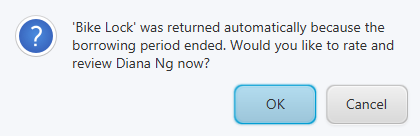
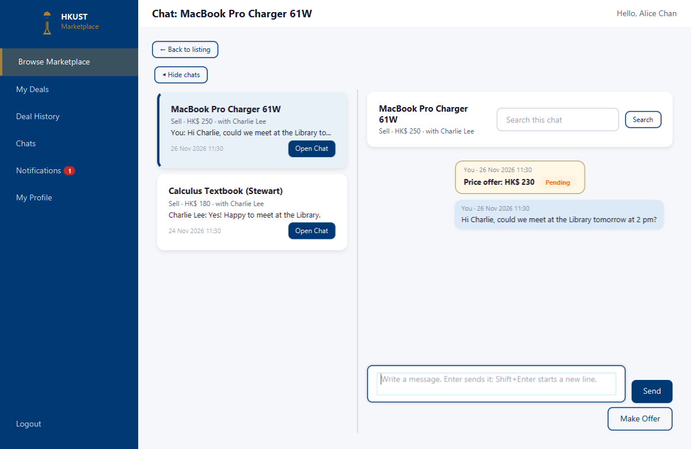
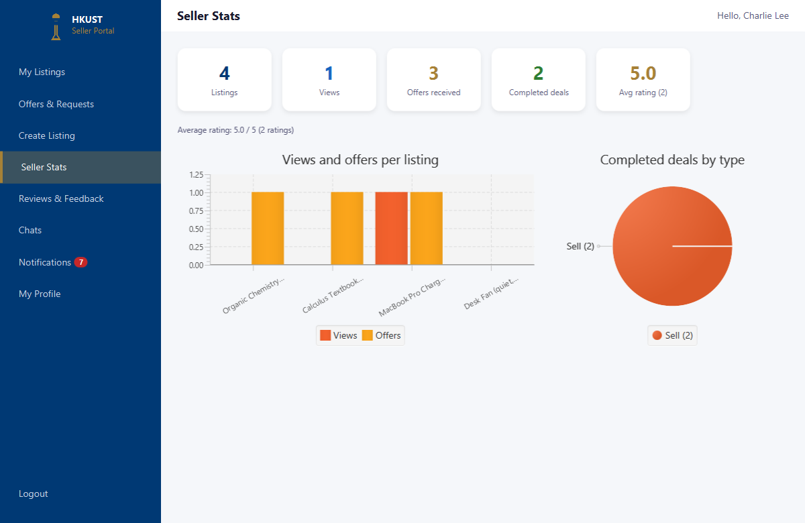

# Supplementary notes

COMP 3111 Group 44, HKUST Marketplace. These notes cover what the brief suggests: the system's characteristics and
WoW factors, an analysis of the algorithms, the results and their justification, and the assumptions and
limitations. They also describe how we built the system. The other submission documents are linked from the
[README](../README.md#submission-documents).

Figures are from the clean build of 26 Nov 2026 (`.\mvnw.cmd clean verify`).

| Document | What it holds |
|---|---|
| [README](../README.md) | setup and running, demo accounts, features, saved data, reports, the coverage policy |
| [walkthrough.md](walkthrough.md) | 68 screenshots with inputs and outputs: one demo story through the three portals with valid input, then each task's message for invalid input |
| [acceptance-tests.md](acceptance-tests.md) | 178 acceptance scenarios with steps, expected results and recorded results |
| [regression-log.md](regression-log.md) | every bug found, with the input that reproduces it and the test that keeps it fixed |
| [assumptions-register.md](assumptions-register.md) | 94 behaviours that the requirements leave open, with who decided and when |
| [client-answers.md](client-answers.md) | the client's (TA's) answers and what each changed |
| [state-machines.md](state-machines.md) | the Listing and Offer state machines that the code enforces |
| [course-concepts.md](course-concepts.md) | where each COMP 3111 concept is applied in the code and tests |
| [storage-manual.md](storage-manual.md) | the data store, the encrypted save file, and its guarantees |

---

## 1. Characteristics and WoW factors

We added no features outside the brief. Instead, we went deeper on each requirement. Every point below is written
as "the requirement asks for X; we also do Y", with evidence that can be checked.

| Point | The requirement asks for | What we also do | Evidence |
|---|---|---|---|
| Security | hashed credentials, "securely stored" data | salted PBKDF2 password hashes; every byte of data encrypted, tampering detected, crash-safe saving; role checks in every service method | `PasswordHasher`, `EncryptedJsonStorage`, `AccessControlTest`, `PersistenceTest` |
| A system that runs by itself | a timer that reminds and returns (UC12) | checks twice a second; catches up on loans that fell due while the app was closed; reminders that adapt to short loans; open screens update by themselves | `BorrowingDeadlineService`, `LiveUpdates`; AT-UC12-01 to 09 |
| One consistent UI | a consistent interface across the portals | one shared listing card, chat screen, Notification Board, profile screen and listing view for every portal; every page checked automatically for cut-off text | README "Shared Core"; `PortalScreensTest` |
| Testing | a unit-test report and 65% branch coverage | 1338 tests, 97.0% / 87.0% branch coverage, two coverage checks in the build, the real screens tested off screen, tests designed by technique | [section 4](#4-results-and-their-justification) |
| Robust business rules | the use cases' flows | state machines enforced in the code; "first claim wins" under concurrency; account deletion in one atomic step | [state-machines.md](state-machines.md); `DealRulesTest`, `AccountDeletionTest` |
| Requirements engineering | the use cases | written client questions with every answer traced into code and tests; 94 open points decided and recorded | [client-answers.md](client-answers.md), [assumptions-register.md](assumptions-register.md) |

### 1.1 Security and data safety

- **Passwords** are hashed with PBKDF2-HMAC-SHA256, 100,000 iterations and a 16-byte random salt, using the JDK
  alone. The strength rules are listed in the README and shown on every password form.
- **All data is encrypted.** Accounts, listings, offers, chats and notifications are saved in one AES-GCM encrypted
  file after every change; photos and the Audit Log snapshots of deleted accounts are encrypted too. Open
  `marketplace-data/marketplace.dat` in a text editor: it is unreadable.
- **Tampering is detected.** AES-GCM authenticates the file, so an edited or damaged file is refused. It is moved
  aside unchanged (nothing is deleted), and the app starts on the demo data with a warning.
- **Crash-safe saving.** Each save writes a temporary file and then replaces the old one, so a crash cannot leave a
  half-written file.
- **Uploads are checked**: photos are recognised by their content (PNG, JPEG, GIF, BMP), not by their file name.
- **Role checks in every service method**, not only hidden buttons in the screens: a buyer's session cannot call a
  seller's or the admin's operation, and the tests check it.

### 1.2 A system that runs by itself

UC12 asks for a timer that checks at least once a second. Ours checks every 0.5 s and goes further:

- **It catches up.** The first check runs at start-up, so loans that fell due while the app was closed are reminded
  and returned at the next start.
- **Reminders adapt to short loans**: 24 hours before the due time, or halfway through a loan shorter than 48 hours.
  A 5-minute practice loan therefore gets a real reminder after 2.5 minutes.
- **Times to the second.** Borrow periods and due dates are shown to the second, so an item returned on time never
  looks late.
- **Live screens.** The open screen and the unread dot update by themselves when the timer changes data (the Observer
  pattern: `LiveUpdates`). The buyer sees the reminder and the return without a click, and is asked at once to rate
  the seller.

### 1.3 One consistent UI across three portals

- **Shared components**: one listing card, one chat screen, one Notification Board, one profile screen and one
  listing overview serve all three portals, so a feature behaves the same wherever it appears.
- **The chat** lists the user's chats beside the open one, with Hide and Back to Chats; it searches inside a chat;
  it shows deal buttons only when it is that person's turn; and the seller's chat links straight to the matching
  offers on Offers & Requests, so no screen is duplicated.
- **Notifications** have an unread dot with the number on the sidebar, Mark all as read, and a category filter.
- **Small touches**: a refused form keeps what was typed; Back keeps the search filters; dates read the same
  everywhere ("21 Nov 2026").
- **Checked automatically**: a screen test opens every page of the three portals at the app's window size and fails
  if any text is cut to "…".

### 1.4 Testing far beyond a unit-test report

- **1338 tests, all passing**, in 77 test classes. Branch coverage is 97.0% on the logic and 87.0% on the whole
  project, screens included; the build fails below 65% on either measure.
- **The real screens are tested.** The JavaFX screens run off screen (`testsupport/OffScreenApp`): every buyer flow
  and its error cases is driven through the screens, and every page of the seller and admin portals is opened. Their
  own fixes are checked through the screens too: the unread dot, R16 to R18, R20 to R26, the admin's Edit condition
  and Add listing by type.
- **Tests designed by technique**: equivalence partitions and boundary values, state-based tests of the state
  machines, basis-path tests, and thread tests that start two actions at the same instant (`SameMoment`, used in 8
  test classes).
- **Planted bugs**: for three use cases we planted deliberate bugs (three each) to check that the tests catch them.
  They all did.
- **Regression log**: 26 bugs so far, each with its input, the wrong and the right output, its cause, and the test
  that keeps it fixed (for R13 and R14, an acceptance scenario).
- **178 acceptance scenarios** for system testing, written from the use cases.

### 1.5 Robust business rules

- **State machines.** Listings and offers change status only through defined events, and an event that the diagram
  does not allow throws. The diagrams are in [state-machines.md](state-machines.md).
- **Concurrency.** When two buyers claim the same giveaway at the same instant, the first wins and the second is
  told the item is no longer available. A tested lock and transactions make this hold.
- **Account deletion in one atomic step**: open offers declined, listings removed, chats archived to an encrypted
  snapshot and then deleted, reviews kept as "Deleted User", and the username retired.
- **The admin's Notification Board doubles as the accounts' history**: every new account, profile change and admin
  action on an account reaches every admin.

### 1.6 The teammates' highlights

- **Seller Stats** (Daniel, Task 2.8): views, offers, completed deals and rating, with a bar chart of views and offers
  per listing and a pie chart of completed deals by type.
- **All Deals** (Jack, Task 3.5): every deal with filters, its details, and an export of the filtered list to CSV.
- **Manage Users and the accounts' history** (Jack, Tasks 3.3 and 3.6): search and filters, deactivation and
  deletion with reasons, each recorded on every admin's board.

### 1.7 Try it yourself in five minutes

1. Reset the data (`scripts\reset-data.cmd`), run `scripts\practice-data.cmd`, and start the app within a minute
   (`.\mvnw.cmd clean javafx:run`).
2. Log in as `alice`: the red dot on Notifications shows her unread notifications.
3. Open My Deals: the practice *HDMI Cable* is borrowed for 5 minutes. Stay in the app: the reminder arrives after
   2.5 minutes, and at 5 minutes the item is returned by itself and Alice is asked to rate the seller.
4. Open `marketplace-data/marketplace.dat` in a text editor: it is encrypted.
5. Run `.\mvnw.cmd clean verify`: about 1,300 tests, both coverage reports and the JavaDoc, in `target/reports/`.

---

## 2. Optimizations compared with the usual way

**Storage and runtime**

- **One save per user action.** The usual way writes the data file at every change, or only on exit. We group the
  changes of one action in a transaction and save once when it ends; unchanged data is not written again.
- **Crash-safe saving**: a temporary file replaces the old one, instead of overwriting the file in place.
- **The timer costs almost nothing when idle.** Each check first only reads; it opens a transaction and saves only
  when a reminder or a return is due. The usual way saves at every tick, or runs one timer per loan.
- **Screens refresh on events, not by polling**: only when the data has changed.
- **Photos are stored once and loaded in the background.** Each photo is one encrypted file, and the data file
  holds only its id, instead of the images being embedded in the data.
- **Derived values are computed, not stored.** Ratings, seller statistics, availability and "Reported" are
  computed from the data, so they can never get out of step with it.

**Correctness**

- **One lock, transactions and state machines**: concurrent actions cannot both succeed, and a listing cannot jump
  to an illegal status.
- **Every input is checked at the service layer** (the barricade): a price such as "1e3", "NaN" or "99.999" is
  refused in every price field, not only in some screens.
- **The timer survives a failed check**: the next check tries again, and the timer stops cleanly when the app
  closes.

**The test suite: fast and deterministic**

- A clean build of the whole suite, both coverage reports and the JavaDoc takes about two minutes. The 127
  screen tests take about 75 s, because one invisible app is shared and reset between tests instead of being
  started for each test.
- **A simulated clock**: a "24 hours before" reminder is tested in milliseconds, without waiting.
- **No test polls in a sleep loop**: tests wait for the event they need, or for a computed moment, so they do not
  fail at random.
- **Every test run uses a temporary data folder**, so real data is never touched.

**Code quality**

- **Complexity cut, with proof**: the password validation went from cyclomatic complexity 17 to 9, and its
  behaviour was shown to be identical on 300,023 passwords.
- **Shared components instead of copies**: the listing card, the chat, the listing overview, the offer rules and
  the price parsing were each made one shared piece as soon as a second copy appeared.
- **Clean builds**: 0 compiler warnings and 0 JavaDoc warnings. The JSON library (Jackson) was upgraded to 2.18.12
  after IntelliJ flagged known vulnerabilities in the version we started with.

---

## 3. How we built it

AI coding assistants were part of our toolset, as the course encourages. What we want to show is the process
around them: every change, however it was drafted, went through the same steps of requirements, design, review,
tests and integration.

| Phase | Practice | Where to see it |
|---|---|---|
| Requirements | The confirmed use-case specification is the authority. Questions to the client were asked in writing, and the 8 answers of 16 Nov and the 4 follow-ups of 21 Nov are traced into code and tests. Open points were decided and recorded with who and when. | [client-answers.md](client-answers.md), [assumptions-register.md](assumptions-register.md) |
| Design | Boundary, control and entity classes per use case; state machines for Listing and Offer; written plans with alternatives before the larger features (Deal History, Report Listing). | [course-concepts.md](course-concepts.md), [state-machines.md](state-machines.md), the class comments |
| Configuration management | A branch per role (buyer, seller, admin) and 40 pull requests merged into `main`, from the first commit on 11 Oct 2026. Merges were built and checked on a temporary branch first, with written review notes listing the fixes needed. | the GitHub history and pull requests |
| Quality gates | The build fails below 65% branch coverage on two measures. Tests are designed by technique. Every bug gets a test and an entry in the regression log. 178 acceptance scenarios. | [section 4](#4-results-and-their-justification), [regression-log.md](regression-log.md) |
| Team support | The shared core (models, data store, services, shared screens) comes with guides for the seller and admin developers, written so that a teammate or their AI assistant can call it instead of rewriting it. | [shared-core-for-seller.md](shared-core-for-seller.md), [shared-core-for-admin.md](shared-core-for-admin.md) |

---

## 4. Results and their justification

The brief mentions "justifications on the results of your recommendation". This application has no
recommendation feature, so this section justifies the measurable results instead.

| Result | Figure | Check |
|---|---|---|
| Unit and integration tests | 1338 run, 0 failures, 0 errors, 0 skipped (100% pass) | [test report](reports/surefire.html) |
| Branch coverage, measured code | 96.95% (line 97.89%) | [JaCoCo report](reports/jacoco/index.html); the build fails below 65% |
| Branch coverage, whole project | 87.04% (line 89.49%) | [JaCoCo report](reports/jacoco-all/index.html); the build fails below 65% |
| JavaDoc | 0 warnings | [JavaDoc](reports/apidocs/index.html) |
| Timer interval | 0.5 s | UC12 SR1 asks for at least once a second |

**Why two coverage figures.** The requirement says ">65% branch coverage" without saying of which code, so the build
checks both. The *measured code* is the models, data, services and utilities, where all the rules live; the JavaFX
screen controllers are left out because they hold no rules of their own, only calls to the services. The *whole
project* includes the screens. The buyer's screens are covered flow by flow by the screen tests. The seller's and
admin's screens are covered less: the screen tests open every one of their pages and check their own fixes
(`SellerScreensTest`, `AdminListingScreensTest`, `AdminRatingsScreensTest`), and the logic behind them is in
services covered by their own tests. IntelliJ's own coverage run is a cross-check of the JaCoCo figures.

**How the tests were designed.** Each use case's test class says which technique designed which test: equivalence
partitions and boundary values for inputs (prices, borrow periods, dates), state-based tests for the state machines,
basis-path tests for the longer methods, and thread tests for the actions that can collide. The tests run against a
temporary data folder and a simulated clock, so they are fast and give the same result every time.

**Regression and acceptance testing.** The regression log records 26 bugs, each with the input that reproduces it,
the wrong and the right output, and the test that keeps it fixed. The 178 acceptance scenarios cover each use
case's basic flow, each alternative flow and each special requirement that a user can see; their results are
recorded in the scenarios' Result column.

---

## 5. Analysis of the algorithms

Each analysis gives the rule, the steps, the cost and the edge cases. *n* is the number of listings or offers in the
store; every operation runs on data in memory, and the file is touched only when an action saves.

### 5.1 Browse: search, filter and sort (UC8)

`BrowseService.search` takes a `BrowseQuery` (keyword, category, type, condition, price range, sort).

1. Keep the live listings: Live, Reserved or Lent, with an active seller (Reserved and Lent ones are shown greyed
   out).
2. Keep those whose title or description contains the keyword, ignoring case (a blank keyword matches everything).
3. Apply the filters. A giveaway counts as HK$ 0. A lend listing has no price, so a price range leaves it out.
4. Sort: newest first, or by price; lend listings come after the priced ones, and listings with the same price are
   ordered newest first.

**Cost:** one pass over the listings, O(n·m) where m is the length of the text searched, then O(k log k) to sort the
k results. **Edge cases:** a minimum above the maximum, a negative price or letters give the invalid-range message
(A2) and keep the results shown before; no match gives A1. **Tests:** `BrowseServiceTest`, `BrowseScreensTest`;
AT-UC8-01 to 12.

### 5.2 The deal state machines (UC5, UC7, Tasks 2.5, 3.2, 3.7)

A listing goes from Pending Review to Live when the admin approves it (or to Rejected, and back to review when the
seller resubmits it). When a deal is accepted, it becomes Reserved (a sale or a giveaway) or Lent (a loan); it ends
as Sold or Given, or goes back to Live when a lent item is returned. The seller or the admin can take it to
Removed. An offer stays Pending until it is Accepted, Countered (not a claim) or Declined; a Countered offer can only
be declined, and an Accepted offer becomes Completed when the deal is marked complete or the item is returned.
Accepting an offer declines the other open offers on the listing and notifies their buyers. Each status changes only
through a named event, and an event that is not allowed in the current status throws. Every event runs inside one
transaction, which re-checks availability at the moment of recording, so of two buyers claiming the same giveaway at
the same instant only the first succeeds.

**Cost:** O(1) per event, plus one pass over the listing's open offers when one is accepted. **Tests:**
`DealRulesTest` and the state-based tests in `OfferServiceTest`, including thread tests.

### 5.3 Borrowing deadlines (UC12)

The timer calls `BorrowingDeadlineService.process()` every 0.5 s, and once at start-up.

- **Reminder time** = the due time minus 24 hours, or the middle of the period if the period is shorter than 48 hours
  (`BorrowRequest.getReminderTime`).
- **Each check** first looks, read-only, for a borrowed item whose reminder time or due time has come. Most checks
  find none and end there, without a transaction or a save.
- **When there is work**, one transaction sends every due reminder, then returns every due item: the due time becomes
  the completion time, the listing is Live again unless the admin removed it, and the buyer and the seller are
  notified. An item whose reminder and due time both passed while the app was closed is reminded and then returned
  in the same check.

**Cost:** O(n) over the offers per check, read-only when idle. **Edge cases:** the buyer returning the item at the
same moment as the timer (the lock makes one of them win, and the item is returned once); a listing the admin removed
while it was lent (it stays Removed). **Tests:** `BorrowingDeadlineServiceTest` with a simulated clock, the thread
tests, `MyDealsScreensTest`; AT-UC12-01 to 09.

### 5.4 Deal History filters (UC11)

`DealHistoryService` lists the buyer's completed deals, with their deal type (Bought, Borrowed, Received) and outcome
(Completed, Returned, Auto-returned). The filters combine: a deal must match every filter that is set. The date range
is compared by calendar day, with both ends included and either end optional; the seller search ignores case. The
order is newest deal date first, then newest offer first.

**Cost:** O(n) over the offers, then O(k log k) to sort. **Edge cases:** a start after the end (A2, shown inline under
the dates, with the earlier results kept); no deals or no match (A1). **Tests:** `DealHistoryServiceTest`,
`HistoryAndNotificationsScreensTest`; AT-UC11-01 to 12.

### 5.5 Report Listing checks (UC9)

A buyer can report any listing whose detail they can open, once per listing. The check is repeated at submit, inside
the transaction that records the report, so a double submit gives "already reported" (A1) instead of two reports.
The data store itself refuses a report on an unknown listing or by an account that is not a buyer (regression log
R10). Every admin is notified; the seller is never told who reported.

**Cost:** O(r) over the reports to check for an earlier one. **Tests:** `ReportServiceTest`, `ReportScreensTest`;
AT-UC9-01 to 10.

### 5.6 Saving the data file

After each transaction, `EncryptedJsonStorage` turns the whole store into JSON. If the JSON is the same as the last
one saved, nothing is written. Otherwise it is encrypted with AES-GCM under a fresh random nonce, written to a
temporary file, and moved over the old file in one step. On loading, the authentication tag detects any change to the
file.

**Cost:** O(size of the data) per saving action; the data of a campus marketplace stays small. **Tests:**
`EncryptedJsonStorageTest`, `PersistenceTest`.

### 5.7 Password rules

`AccountValidator` checks the rules one by one (at least 8 characters; an uppercase letter, a lowercase letter, a
digit and a special character; ASCII only), and names the first rule that fails. It was refactored into named checks
to cut its cyclomatic complexity from 17 to 9; the old and new versions gave the same answer on 300,023 passwords.

### 5.8 Seller statistics (Task 2.8)

`SellerStatsService` counts everything in one consistent read of the store: the views of all the seller's listings
(a sold or removed listing keeps its views), every offer ever made on them whatever its status, the completed deals
(sold, given, or a borrowed item returned) split by listing type for the pie chart, and the rating over the shown
reviews only (hidden ones are left out). Each listing also gets its own views and offers for the bar chart. **Cost:**
O(n) over the listings and offers. **Tests:** `SellerStatsServiceTest`.

### 5.9 The admin's deal record and CSV export (Task 3.5)

`AdminDealService.findDeals` filters the accepted deals by status, type, seller, buyer and date. `exportCsv` turns
the filtered list into CSV text with a header row; a field that holds a comma, a double quote or a line break is
quoted, and its quotes are doubled, so titles such as `Desk Fan (quiet, 3 speeds)` stay in one column. The service
writes no file; the screen saves the text where the admin chooses. **Cost:** O(n) over the offers to filter, and
O(k) to export k deals.

---

## 6. Assumptions and limitations

### 6.1 Assumptions

Where the task list and the specification leave a behaviour open, we decided it and recorded it in the
[assumptions register](assumptions-register.md): 94 items, grouped by use case, each with its status (settled by a
client answer, decided by the team with the date, an edge case the client left to us, or an implementation choice).
The most visible ones:

- An available listing also needs an active seller (item 2).
- A seller accepts only Pending offers; the buyer agrees to a counter by making a new offer with its terms (3, 71).
- Usernames ignore case (5).
- A Chats page in the buyer and seller portals, because a chat can start without an offer (24).
- Reviews by a deleted buyer are kept and shown as "Deleted User"; the deleted username is retired (31, 33).
- The lending duration is a guide, not a maximum (46).
- Borrow times are shown to the second (64).
- The rate-seller prompt also follows a return, including an automatic one (56, 65).
- "Reported" in the admin's filter is derived from the reports, not a listing status (87).
- The admin's Notification Board is the accounts' history (88).

### 6.2 Limitations

- **Not a Java module (L1).** JavaFX therefore prints a harmless "Unsupported JavaFX configuration" warning at
  start-up, and the app is run through Maven rather than by running `MarketplaceApp` directly.
- **The encryption key is built into the code** (item 13): the file cannot be read or changed without the source
  code, but anyone with the source code can decrypt it. A real deployment would keep the key outside the code.
- **One computer, one user at a time.** The app is a desktop application with one local data file and no server:
  one person uses it at a time and switches portals by logging out. Inside the app, the timer and the user acting
  at the same moment are handled by the lock and the transactions. Two copies of the app running on the same data
  folder at once are not supported: each saves its own copy of the data, and the last save wins.
- **No rollback.** The services check everything before they change anything, so a refused action leaves the data
  unchanged, and a transaction saves only when it ends without an error. An unexpected error in the middle of a
  change, however, is not undone in memory, and the next save would include the partial change.
- **Stored photos are never deleted** (item 38): a photo of an edited or cancelled listing stays as an unused file.
- **A deal that cannot be finished** (client question F1): if a buyer is deleted or deactivated after their purchase
  is accepted, the listing stays Reserved until the admin removes it.
- **The lending duration is not enforced** as a maximum (item 46): the seller counters or declines a longer request.
