# Walkthrough: the application in screenshots

These screenshots show the application running, with sample inputs and the outputs they produce. They follow one
story through the three portals, starting from the demo data after a reset (`scripts\reset-data.cmd`):

1. [A new student registers, and Alice logs in](#1-start-welcome-registration-and-login).
2. [Alice, a buyer](#2-buyer-alice), browses, makes an offer, chats, completes a deal, reviews the seller and reports a listing.
3. [Charlie, a seller](#3-seller-charlie), counters the offer, posts a new listing and replies to the review.
4. [The admin](#4-admin) approves the listing and looks at the report, the users, the deals and the ratings.
5. [Bob's borrowed item reaches its due date](#5-borrowing-deadlines-bob): the app reminds him, then returns it by itself.

Each step gives the input, the output, and the acceptance scenarios in [acceptance-tests.md](acceptance-tests.md)
that check the same behaviour in more detail. Later steps show the effects of earlier ones: Alice's offer reaches
Charlie, her review reaches his reviews page and the admin's ratings page, and her report and the new account reach
the admin's notifications.

**How the screenshots were taken.** They come from the real screens and services, captured on 26 Nov 2026 at the
window's default size (1200 × 780). A short capture script, which is not part of the build, drove the application
through the off-screen harness that the screen tests use (`testsupport/OffScreenApp`). It typed the inputs listed
here, pressed the buttons, and saved each screen and each dialog as it appeared. Dialogs are shown without their
window frame. Dates and times are the capture's clock. To repeat a step by hand, reset the data, start the app with
`.\mvnw.cmd clean javafx:run`, and follow the inputs.

Demo accounts: buyers `alice` and `bob`; sellers `charlie` and `diana` (password `Demo@1234`); admin `admin`
(`Admin@1234`).

---

## 1. Start: welcome, registration and login

### 1.1 Welcome screen

- **Input:** start the app.
- **Output:** the three portals. Each portal has its own login, and an account belongs to one portal.

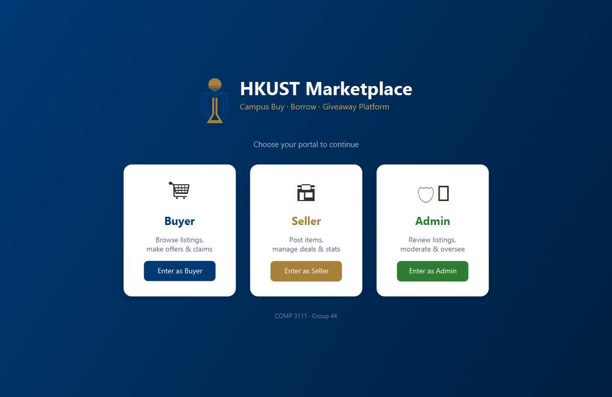

### 1.2 Registration with a weak password (UC1)

- **Input:** Enter as Buyer, then Register here. Username `eve`, full name `Eve Lam`, password and confirmation
  `password1`, residence hall `UG Hall 1`. Create Account.
- **Output:** no account is created. The message names the rule that failed (no uppercase letter) and lists all the
  password rules.
- **Checked by:** `BuyerAccountScreensTest`, `AuthServiceTest`.

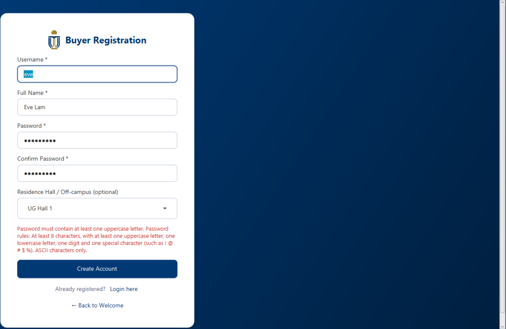

### 1.3 Registration succeeds

- **Input:** password and confirmation `Secure#123`. Create Account.
- **Output:** "Registration successful! You can now login." The form is cleared. Every admin is told about the new
  account (see [4.7](#47-the-admins-notification-board-task-36)).
- **Checked by:** `BuyerAccountScreensTest`; AT-UC4A-01 for the admin's notification.

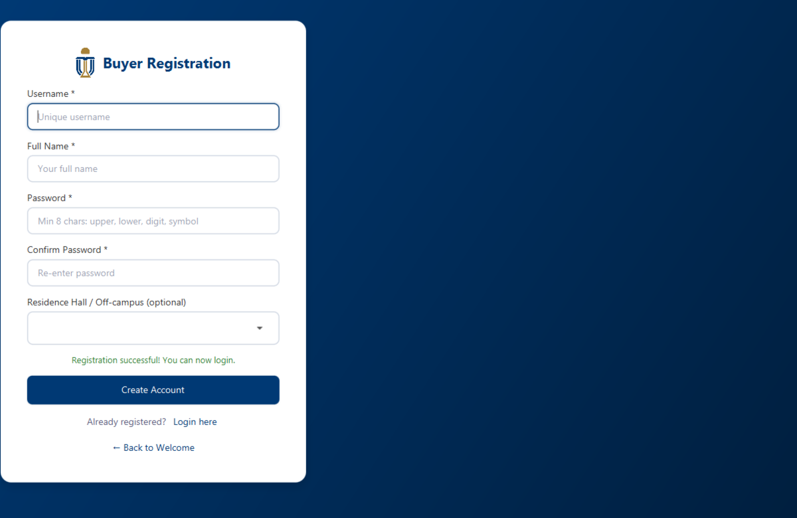

### 1.4 Buyer login (UC2)

- **Input:** on the buyer login, username `alice` and password `Demo@1234`. Login.
- **Output:** the buyer portal opens on Browse Marketplace (next step). Under the form, the login screen shows the
  demo credentials.
- **Checked by:** `BuyerAccountScreensTest`, `AuthServiceTest`.

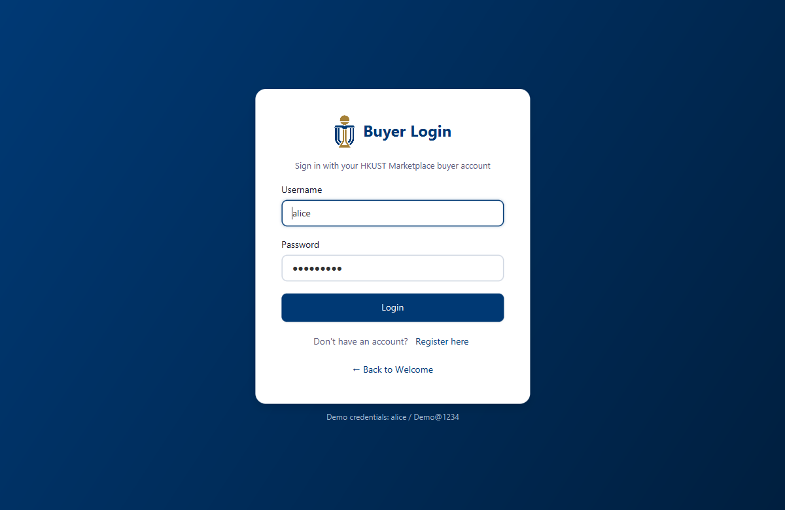

---

## 2. Buyer: Alice

### 2.1 Browse Marketplace (UC8)

- **Input:** none; this is the first page after login.
- **Output:** four listings, newest first. Each card shows the photo (or "No photo"), the type, the availability, the
  price, the title, the category, the condition, the seller, the meet-up location and the posting date. The
  *Calculus Textbook (Stewart)*, at the bottom, is greyed out because it is Reserved for Alice. The red **1** on
  Notifications is the unread dot: Alice has one unread notification.
- **Checked by:** AT-UC8-01, AT-UC4-01.

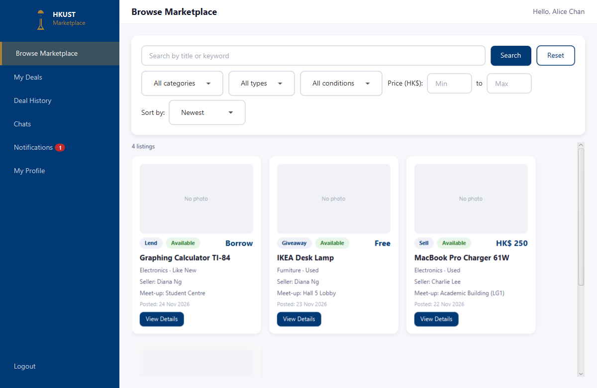

### 2.2 Search by keyword

- **Input:** `textbook` in the search box. Search.
- **Output:** "1 listing": the calculus textbook (Reserved, so still greyed out).
- **Checked by:** AT-UC8-02.

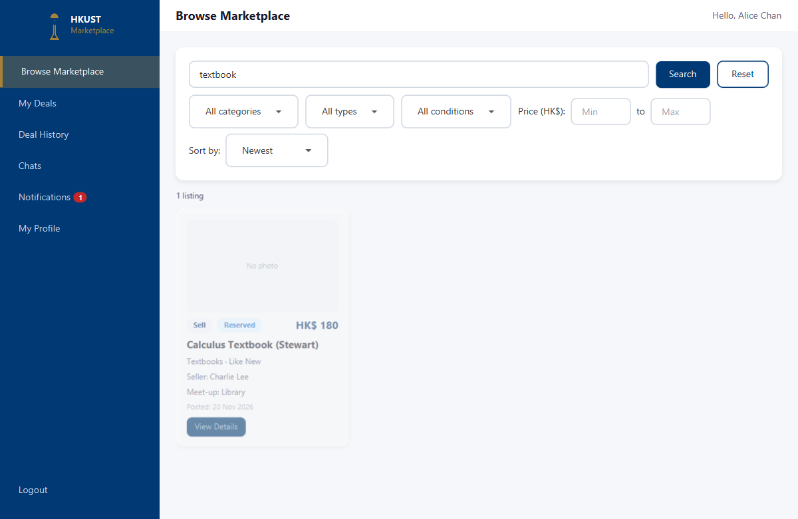

### 2.3 Listing detail

- **Input:** Reset, then View Details on the *MacBook Pro Charger 61W*.
- **Output:** every field of the listing, including the view count (each opening adds one), the description, and the
  three actions Make Offer, Chat with Seller and Report Listing. Lower down the page are the seller's name and rating,
  and the reviews.
- **Checked by:** AT-UC8-08.

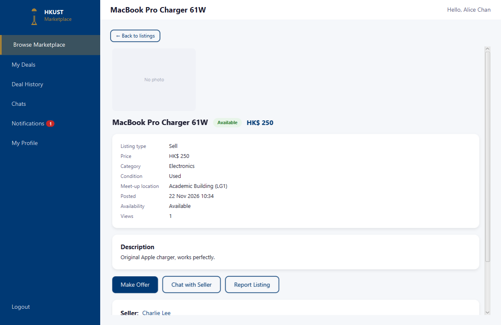

### 2.4 Make Offer (UC5)

- **Input:** Make Offer. Price `230` (the form starts at the asking price, 250). Submit.
- **Output:** the form shows the asking price and what the seller can do with the offer. The confirmation names the
  price and says that the seller has been notified. The charger stays Available until the seller accepts.
- **Checked by:** AT-UC5-01, AT-UC5-05 and AT-UC5-06 for invalid prices.

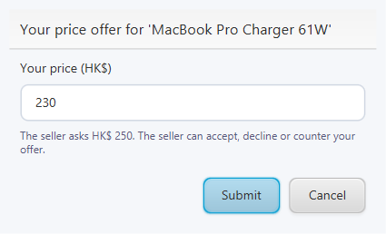

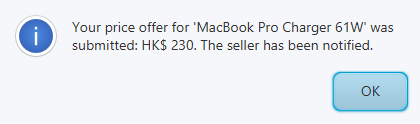

### 2.5 Chat with the seller (UC6)

- **Input:** Chat with Seller. Type `Hi Charlie, could we meet at the Library tomorrow at 2 pm?` Send.
- **Output:** Alice's chats are listed beside the open one. This chat is marked and is at the top, because it has the
  newest message. The offer from step 2.4 is in the chat as "Price offer: HK$ 230", Pending, followed by the message.
  Make Offer, under Send, makes another offer from the chat.
- **Checked by:** AT-CHAT-01, AT-CHAT-13, AT-CHAT-17, AT-CHAT-18.

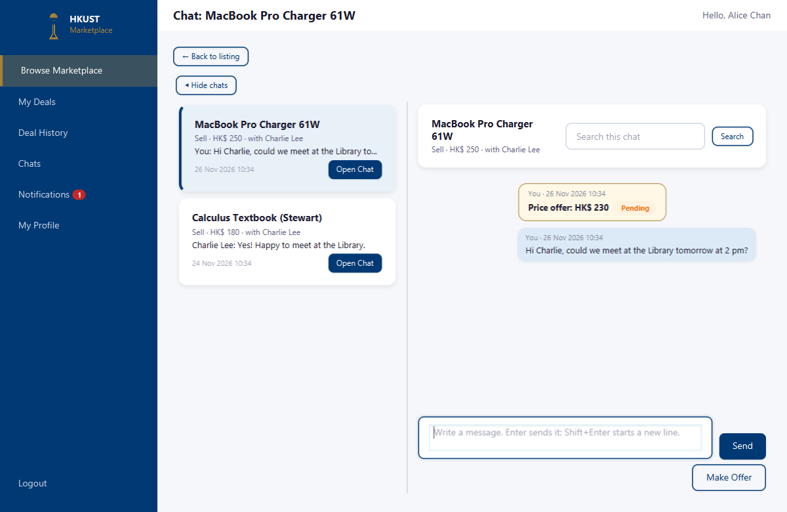

### 2.6 Search inside a chat

- **Input:** `Library` in "Search this chat". Search.
- **Output:** "1 message contains 'Library'." and the message, above the chat. Close search hides the results.
- **Checked by:** `ChatScreensTest`.

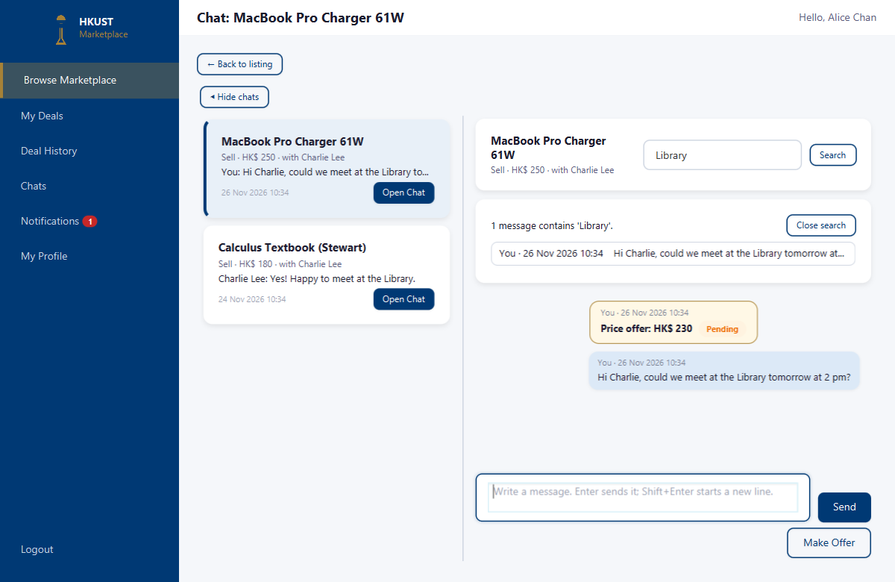

### 2.7 My Deals (UC7)

- **Input:** My Deals.
- **Output:** the current deals. The charger offer is Pending. The calculus textbook offer (HK$ 160) was accepted by
  Charlie, so it has Mark Complete. Each deal can reopen its listing or its chat.
- **Checked by:** AT-UC7-01, AT-UC7-09.

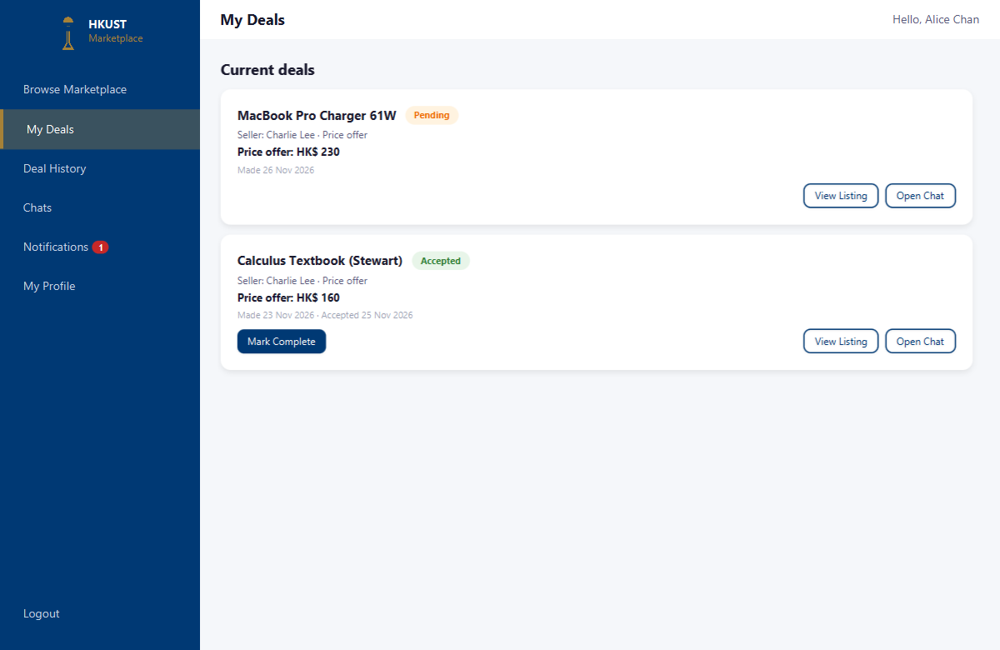

### 2.8 Mark Complete, then Review Seller (UC7, UC10)

- **Input:** Mark Complete on the calculus textbook. OK to confirm, then OK on "Deal completed". In the review prompt
  that follows, choose 5 ★ and type `The book is in great condition, and Charlie was on time.` Submit Review.
- **Output:** the deal is completed and the listing becomes Sold. The prompt says where the review will show and that
  it cannot be changed once submitted. Charlie is notified of the review.
- **Checked by:** AT-UC7-04, AT-UC7-05, AT-UC10-01 to AT-UC10-05.

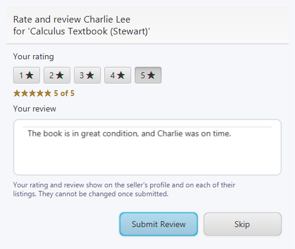

### 2.9 My Deals after the review

- **Output:** the textbook has moved to Completed deals, with the date it was made, accepted and completed.
- **Checked by:** AT-UC7-02.

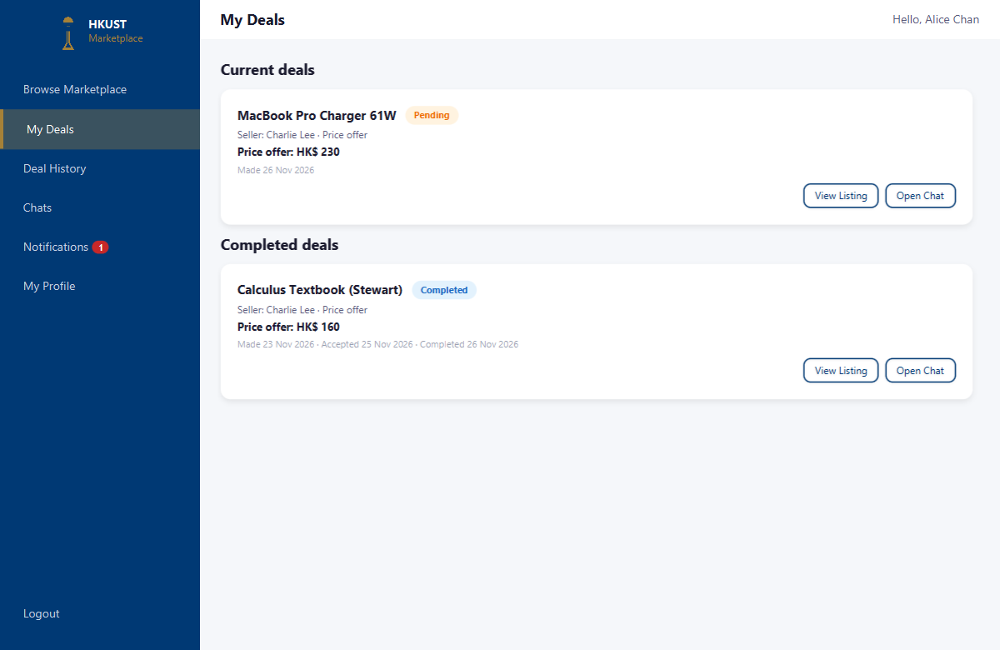

### 2.10 Deal History (UC11)

- **Input:** Deal History.
- **Output:** one completed deal: *Calculus Textbook (Stewart)*, Charlie Lee, 26 Nov 2026, Bought, Completed. The
  filters search by the seller's name, a date range and a category.
- **Checked by:** AT-UC11-01, AT-UC11-03.

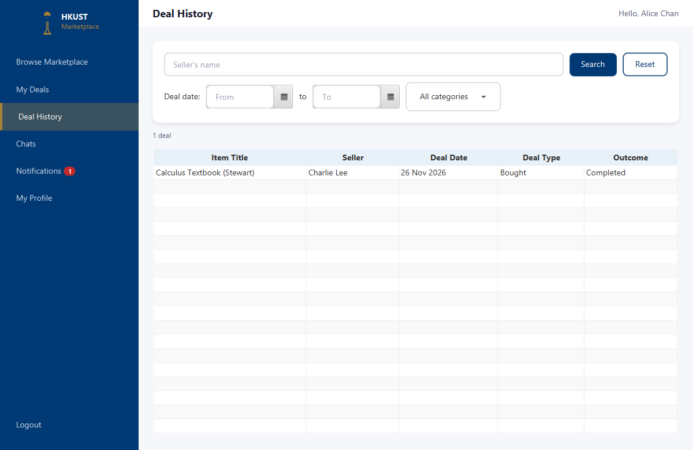

### 2.11 Report Listing (UC9)

- **Input:** Browse Marketplace, View Details on the *IKEA Desk Lamp*, Report Listing. Reason "Misleading
  description", details `The photo shows a different lamp from the one described.` Submit Report.
- **Output:** the report is saved and every admin is notified. The seller is never told who reported the listing (see
  [4.3](#43-listing-details-with-the-report-task-37) and [4.7](#47-the-admins-notification-board-task-36)).
- **Checked by:** AT-UC9-01, AT-UC9-02.

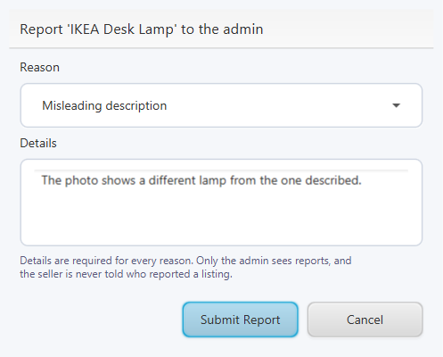

### 2.12 Notification Board (UC4)

- **Input:** Notifications.
- **Output:** "1 unread notification": an Offer Update, "Charlie Lee accepted your price offer for 'Calculus
  Textbook (Stewart)'.", marked Unread. Each notification has Mark as read, and the board has Mark all as read and
  a category filter. Opening the board marks nothing as read, so the dot stays at 1.
- **Checked by:** AT-UC4-01, AT-UC4-02, AT-UC4-04, AT-UC4-06.

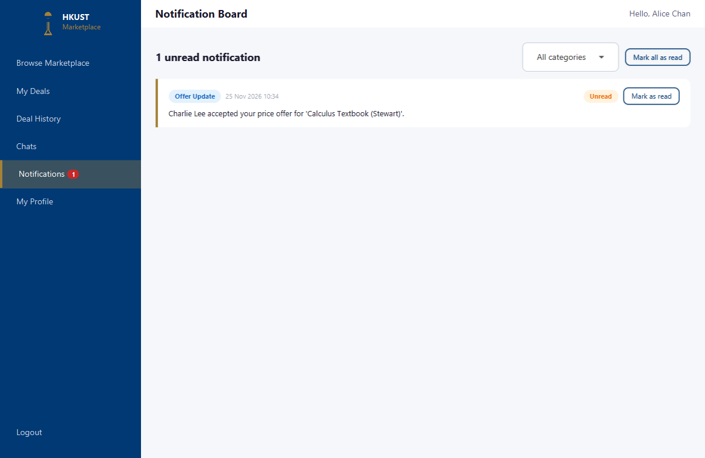

### 2.13 My Profile

- **Input:** My Profile.
- **Output:** the username and the residence hall cannot be changed. The full name and the password can, and the
  password rules are shown. A saved change is reported to every admin.
- **Checked by:** `ProfileServiceTest`; AT-UC4A-03.

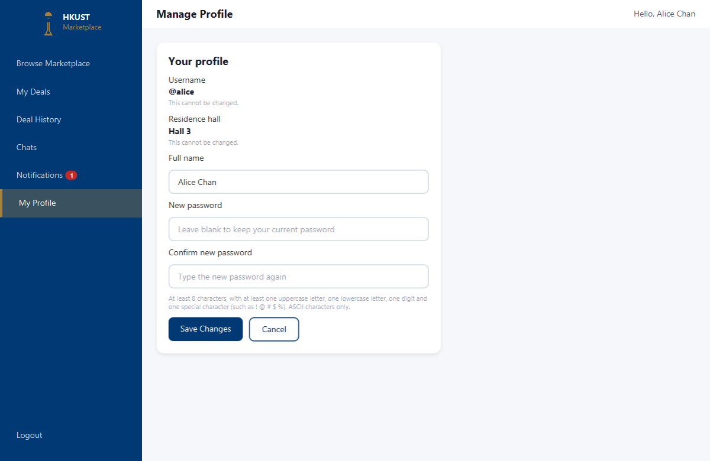

---

## 3. Seller: Charlie

### 3.1 My Listings (Task 2.4)

- **Input:** Enter as Seller, log in as `charlie`.
- **Output:** his listings with type, status and price, each with Edit and Delete. The calculus textbook is Sold after
  step 2.8. The dot shows 6 unread notifications, including Alice's offer and her review.
- **Checked by:** AT-2.4-01.

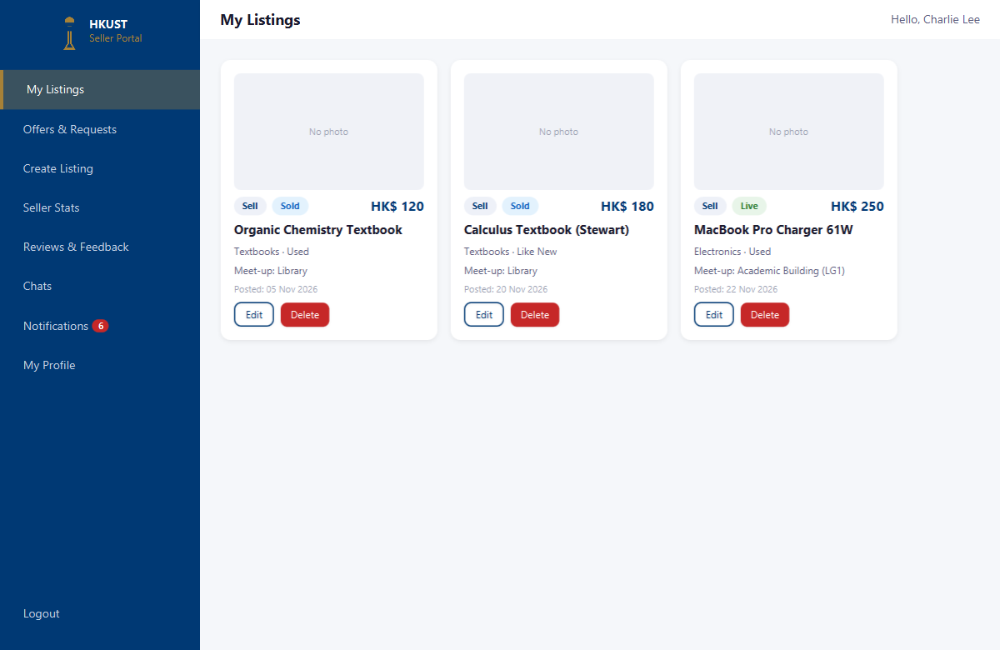

### 3.2 Offers & Requests (Task 2.5)

- **Input:** Offers & Requests.
- **Output:** Alice's offer from step 2.4, HK$ 230, Pending, with Accept, Decline, Counter and Open Chat.
- **Checked by:** AT-2.5-01, AT-2.5-07.

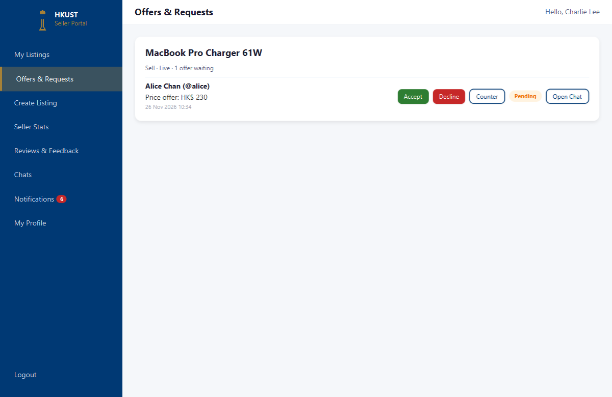

### 3.3 Counter the offer

- **Input:** Counter. New price `240`. Send counter.
- **Output:** the offer becomes Countered and Alice is notified. She can agree to the counter from her chat or from My
  Deals.
- **Checked by:** AT-2.5-04, AT-UC5-12.

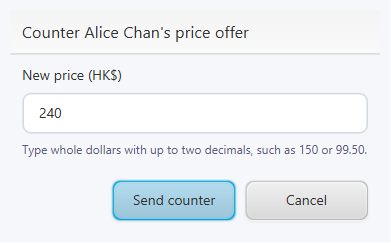

### 3.4 Create Listing (Task 2.3)

- **Input:** Create Listing. Type Sell, item name `Desk Fan (quiet, 3 speeds)`, category Furniture, condition Like New,
  description `Bought in September and works perfectly; the box is included.`, price `120`, meet-up location Student
  Centre (lower down the form).
- **Output:** the form follows the type: for a sale the price is required and the lending duration is disabled.
- **Checked by:** AT-2.3-01, AT-2.3-04.

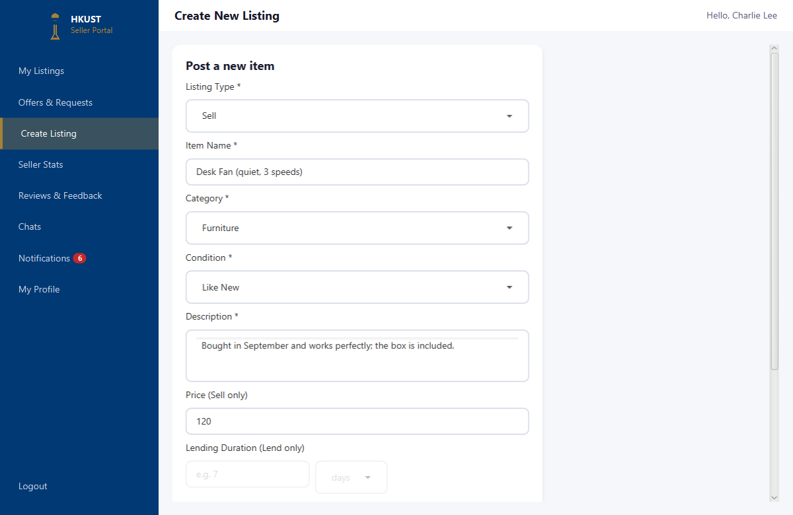

### 3.5 Submitted for review

- **Input:** Submit for Review.
- **Output:** "'Desk Fan (quiet, 3 speeds)' is now Pending Review. The admin has been notified." Buyers do not see it
  until the admin approves it (step 4.1).
- **Checked by:** AT-2.3-10.

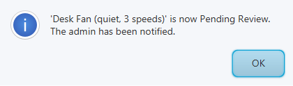

### 3.6 Seller Stats (Task 2.8)

- **Input:** Seller Stats.
- **Output:** 4 listings, 1 view, 3 offers received, 2 completed deals, and an average rating of 5.0 from 2 ratings.
  Below are a bar chart of views and offers per listing and a pie chart of completed deals by type.
- **Checked by:** AT-2.8-01, AT-2.8-02, AT-2.8-04.

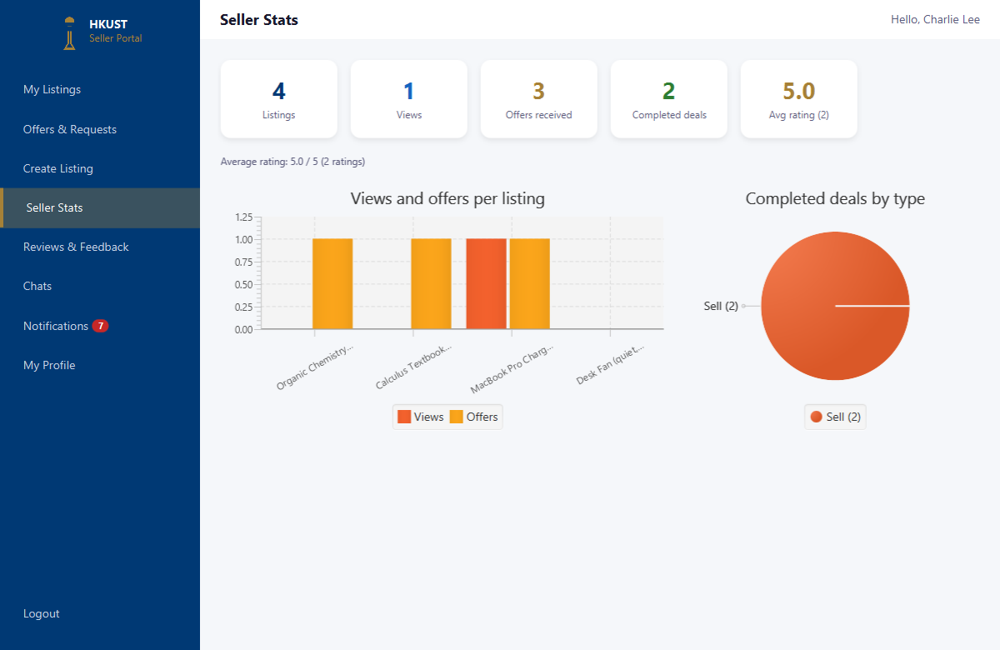

### 3.7 Reply to a review (Task 2.9)

- **Input:** Reviews & Feedback, Reply on Alice's review. `Thank you, Alice! I'm glad the book helps.` Send reply.
- **Output:** the form says that the buyer is notified and that a review can have one reply.
- **Checked by:** AT-2.9-02.

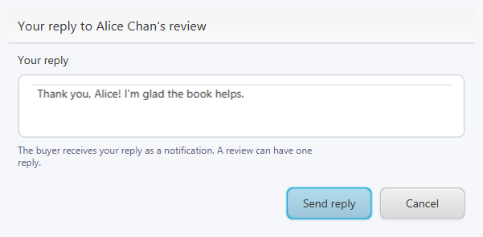

### 3.8 Reviews & Feedback

- **Output:** both of Charlie's reviews with their writer, listing and date. Alice's review from step 2.8 now shows
  "Your reply: …", and its button has become Replied (disabled), because a review takes one reply only. Flag reports
  an inappropriate review to the admin.
- **Checked by:** AT-2.9-01, AT-2.9-03.

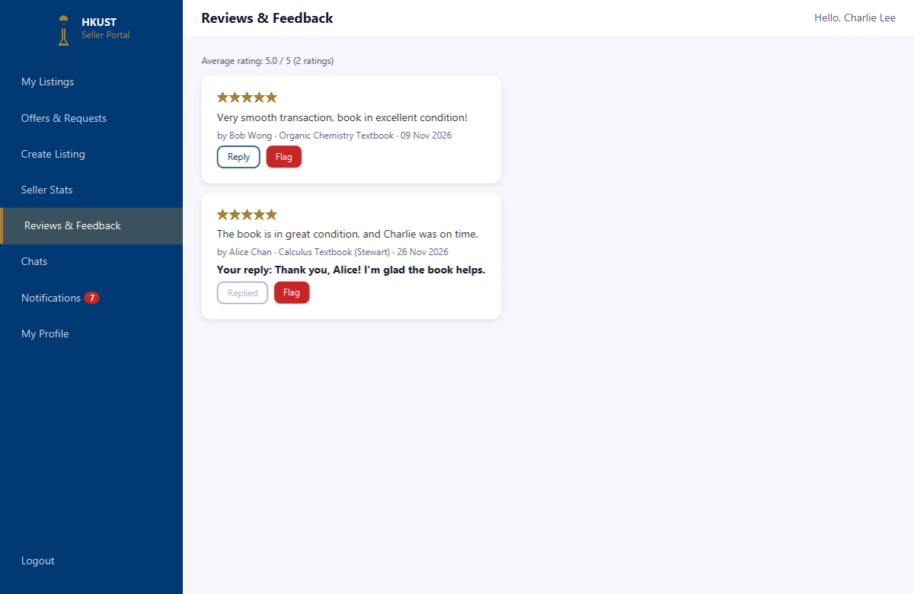

### 3.9 The seller's chat

- **Input:** Chats, Open Chat on the charger.
- **Output:** the same chat as Alice's in step 2.5, seen by the seller. The offer now shows Countered with "Seller's
  counter: HK$ 240". Under Send, "Respond in Offers & Requests (1)" opens the offers on this listing.
- **Checked by:** AT-CHAT-06, AT-CHAT-07, AT-CHAT-19.

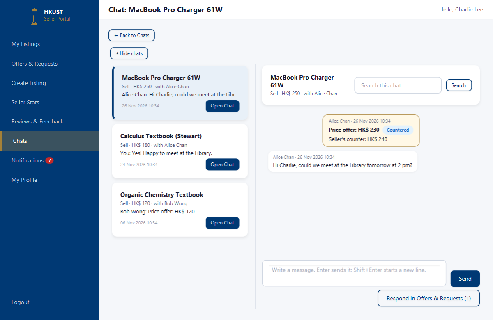

---

## 4. Admin

### 4.1 Listing Review (Task 3.2)

- **Input:** Enter as Admin, log in as `admin`.
- **Output:** the listings waiting for review: Charlie's desk fan from step 3.5 and Diana's *Mini Fridge*, each with
  Approve and Reject. Next, Approve on the desk fan, confirmed with OK, makes it Live and tells Charlie.
- **Checked by:** AT-UC3A-02.

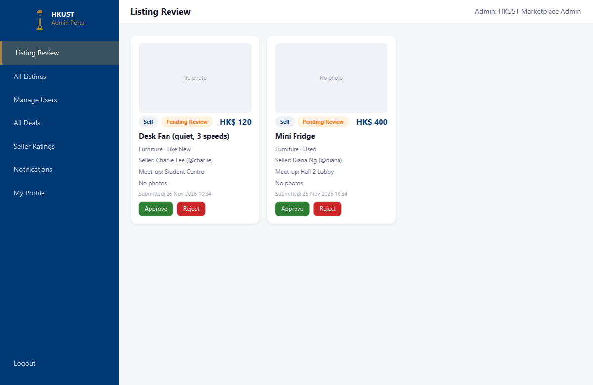

### 4.2 All Listings (Task 3.7)

- **Input:** All Listings.
- **Output:** every listing in any status, with filters by status, category, type, seller and date. The desk fan is
  now Live.
- **Checked by:** AT-UC3A-01.

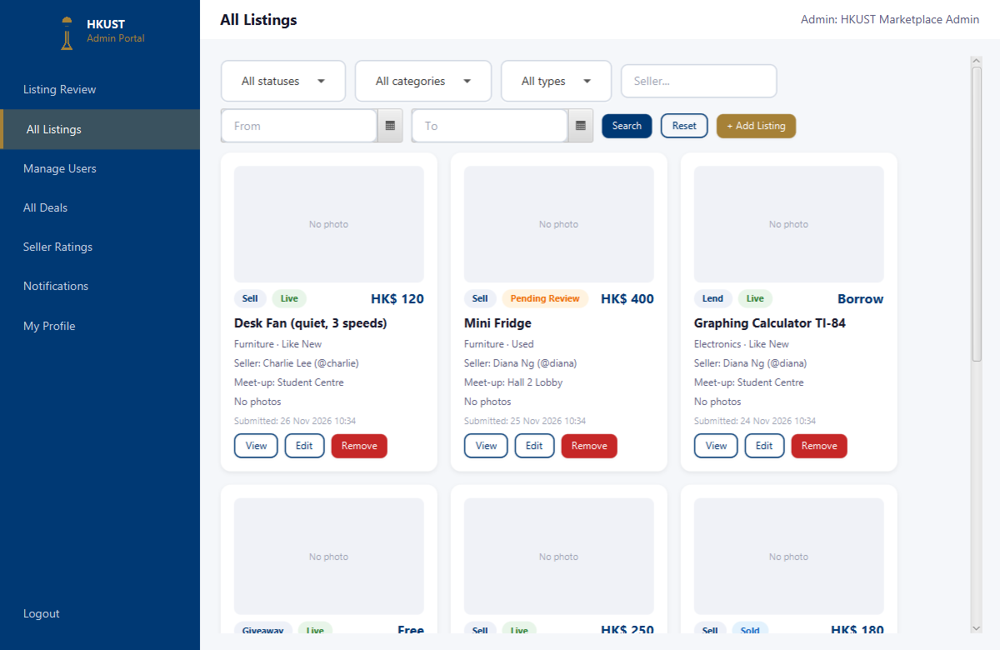

### 4.3 Listing details with the report (Task 3.7)

- **Input:** View on the *IKEA Desk Lamp*.
- **Output:** the listing's details and "Reports (1)": Alice's report from step 2.11, with its reason and details.
  From here the admin can Edit or Remove the listing.
- **Checked by:** AT-UC3A-03, AT-UC9-02.

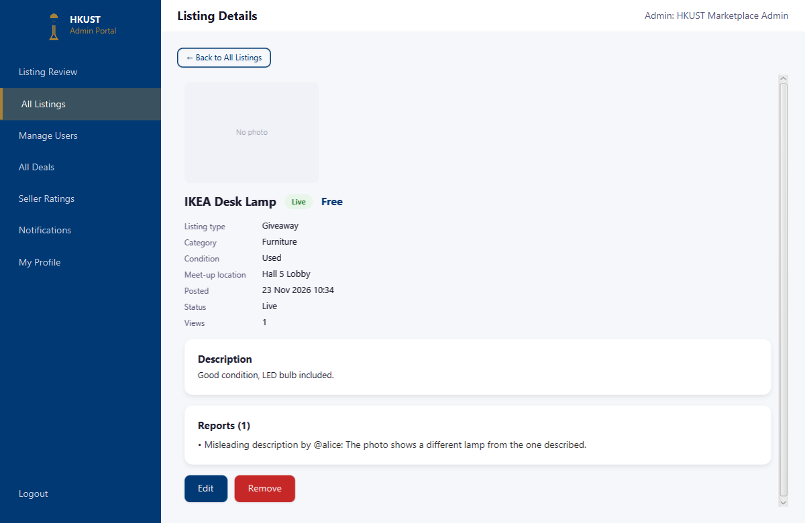

### 4.4 Manage Users (Task 3.3)

- **Input:** Manage Users.
- **Output:** every account with its role, registration date and status, including Eve Lam, registered in step 1.3.
  Each account has View, Edit, Deactivate and Delete.
- **Checked by:** AT-UC3U-01, AT-UC3U-02.

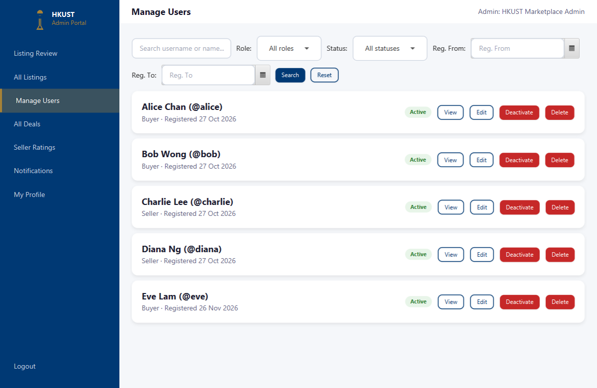

### 4.5 All Deals (Task 3.5)

- **Input:** All Deals.
- **Output:** every accepted deal with buyer, seller, type, start date, return or completion date, and status. Alice's
  textbook deal from step 2.8 is Completed. Filters and Export CSV are above the table.
- **Checked by:** AT-UC3D-01, AT-UC3D-02.

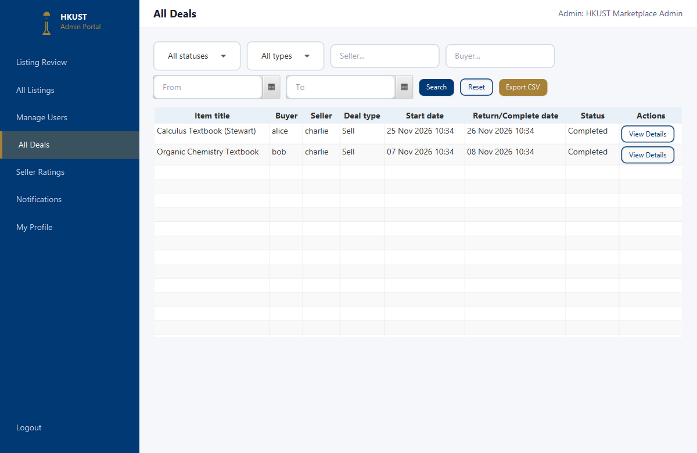

### 4.6 Seller Ratings (Task 3.8)

- **Input:** Seller Ratings, View Reviews on Charlie Lee.
- **Output:** Charlie's reviews, including Alice's from step 2.8, with filters by score and date. Hide removes a review
  from every page, with a reason.
- **Checked by:** AT-UC3R-01, AT-UC3R-02, AT-UC3R-03.

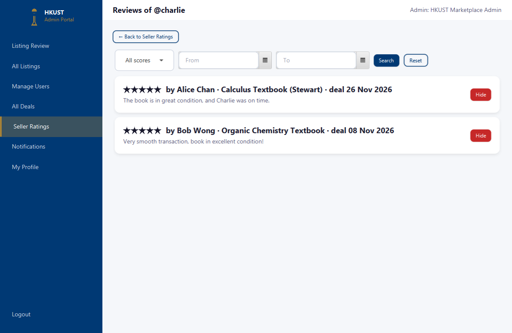

### 4.7 The admin's Notification Board (Task 3.6)

- **Input:** Notifications.
- **Output:** 4 unread notifications, all caused by earlier steps: Charlie submitted the desk fan (3.5), the lamp was
  reported (2.11), Eve's new buyer account (1.3), and Diana's *Mini Fridge* from the demo data.
- **Checked by:** AT-UC4A-01, AT-UC9-02.

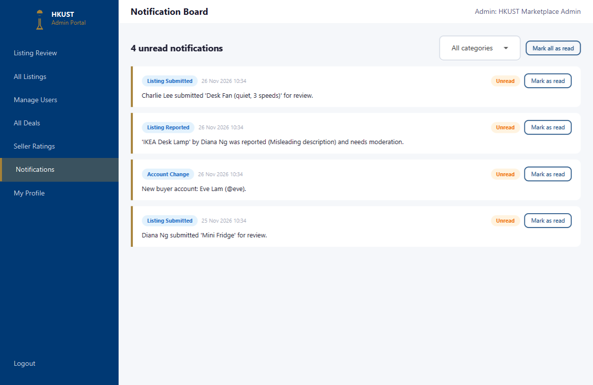

---

## 5. Borrowing deadlines: Bob

A real loan lasts hours or days, so for this part the loan was added directly to the data: Diana lends Bob a *Bike
Lock*, from one hour before the first screenshot until a few seconds after it. Its reminder time is halfway through
the period, because the period is shorter than 48 hours, so that time has already passed. The reminder and the
return are the application's own work: the deadline check (`BorrowingDeadlineService.process()`), which the app's
timer runs every half second, was run at the two moments shown. In the running app the timer does this by itself,
and the open screen updates at once.

### 5.1 A borrowed item (UC7)

- **Input:** log in as `bob`. My Deals.
- **Output:** the Bike Lock is Accepted, with the borrow period, its due date and Return Item. Bob's pending request
  for the calculator, from the demo data, is below it.
- **Checked by:** AT-UC7-01, AT-UC7-10.

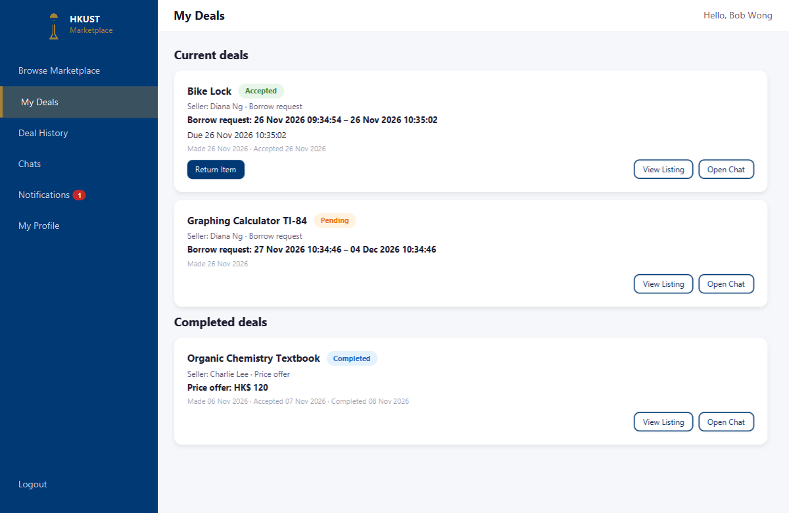

### 5.2 Due-date reminder (UC12)

- **Input:** the deadline check runs after the reminder time.
- **Output:** a Due-Date Reminder, "Reminder: 'Bike Lock' is due on …", with the due date to the second. The dot
  rises at once.
- **Checked by:** AT-UC12-01, AT-UC4-07.

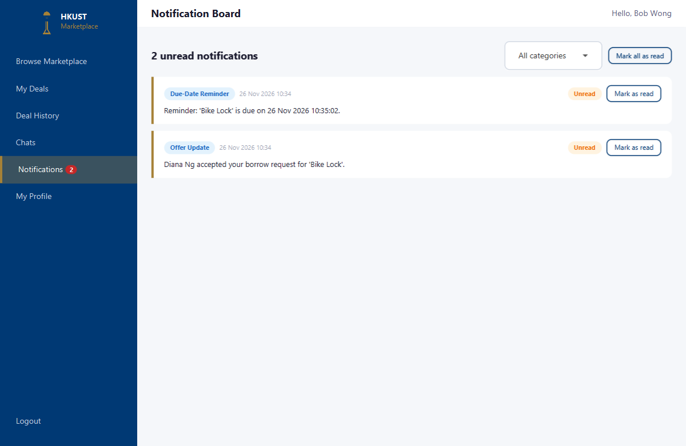

### 5.3 Automatic return (UC12, UC10)

- **Input:** the deadline check runs after the due date, while Bob is on My Deals.
- **Output:** "'Bike Lock' was returned automatically because the borrowing period ended. Would you like to rate and
  review Diana Ng now?" Cancel leaves the review for later.
- **Checked by:** AT-UC12-03, AT-UC10-08.

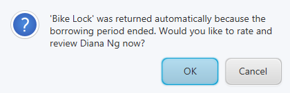

### 5.4 After the return

- **Output:** the Bike Lock is under Completed deals as Auto-returned ("Returned automatically 26 Nov 2026"), with
  Rate Seller for the review that Bob skipped. The listing is Live again for other buyers. Bob and Diana are both
  notified, and Bob's dot now shows 3.
- **Checked by:** AT-UC12-03 to AT-UC12-05, AT-UC10-08.

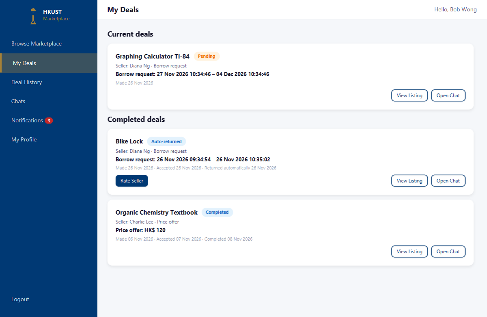
